# How to Update Teranode with Kubernetes Helm

Last modified: 19-October-2026

## Introduction

This guide provides instructions for updating Teranode in a Kubernetes environment using Helm.

## Prerequisites

Ensure you have:

- Access to the ECR registry
- AWS CLI configured
- Helm installed
- Existing Teranode deployment

## Update Process



### 1. Set Version Variables

```bash
# Set new versions
export OPERATOR_VERSION=<new-version>
export TERANODE_VERSION=<new-version>
export GHCR_REGISTRY=ghcr.io/bsv-blockchain
```

### 2. Update Images

```bash
# Pull new images
docker pull $GHCR_REGISTRY/teranode-operator:$OPERATOR_VERSION
docker pull $GHCR_REGISTRY/teranode:$TERANODE_VERSION

# Load into Minikube
minikube image load $GHCR_REGISTRY/teranode-operator:$OPERATOR_VERSION
minikube image load $GHCR_REGISTRY/teranode:$TERANODE_VERSION
```

### 3. Update Operator

```bash
# Update operator
helm upgrade teranode-operator oci://ghcr.io/bsv-blockchain/helm/teranode-operator \
    -n teranode-operator \
    -f kubernetes/teranode/teranode-operator.yaml
```

### 4. Verify Update

```bash
# Check all pods are running
kubectl get pods -n teranode-operator | grep -E 'aerospike|postgres|kafka|teranode-operator'

# Check Teranode services are ready
kubectl wait --for=condition=ready pod -l app=blockchain -n teranode-operator --timeout=300s

# View Teranode logs
kubectl logs -n teranode-operator -l app=blockchain -f
```

## Production Considerations

For production deployments:

- Create backups before updating
- Review release notes for breaking changes
- Test updates in a staging environment first
- Monitor system during and after update
- Have a rollback plan prepared (see [Roll Back](#roll-back))
- Changes to the PostgreSQL `init.sql` ConfigMap do not apply to an existing
  persistent volume. If you provisioned the cluster before Teranode dropped
  superuser from the `teranode` PostgreSQL role, apply the one-off `ALTER ROLE`
  in [PostgreSQL Role Privileges](minersSecurityBestPractices.md#postgresql-role-privileges)

## Roll Back

Before you roll back, read the release notes of every version between the
target version and the current version. Look for data-format, schema or
migration warnings.

Teranode applies blockchain store schema changes on startup, and it only
applies them forward. If a release in that range changes data formats, do not
only change the image version. Restore the backup that you took before the
upgrade, as described in [How to Back Up and Restore Teranode Data](../minersHowToBackup.md).

### 1. Roll Back the Teranode Image

The Teranode image comes from `spec.image` in the Cluster CR. Set it to the
previous release tag:

```yaml
spec:
  image: ghcr.io/bsv-blockchain/teranode:<previous-version>
```

Load the image if your cluster cannot pull it, then apply the CR:

```bash
minikube image load ghcr.io/bsv-blockchain/teranode:<previous-version>
kubectl apply -f kubernetes/teranode/teranode-cr.yaml -n teranode-operator
```

### 2. Roll Back the Operator (if you upgraded it)

```bash
# Find the revision before the upgrade
helm history teranode-operator -n teranode-operator

# Roll back to that revision
helm rollback teranode-operator <revision> -n teranode-operator
```

`helm rollback` does not roll back the CRDs, because the install applies them
with `kubectl apply`. If the new operator version changed the CRDs, apply the
CRDs of the previous operator version:

```bash
kubectl apply --server-side -f https://raw.githubusercontent.com/bsv-blockchain/teranode-operator/<previous-operator-version>/deploy/crds.yaml
```

### 3. Verify the Rollback

```bash
# Check that the pods run the previous image
kubectl get pods -n teranode-operator -o jsonpath='{range .items[*]}{.metadata.name}{"\t"}{.spec.containers[*].image}{"\n"}{end}'

# Check Teranode services are ready
kubectl wait --for=condition=ready pod -l app=blockchain -n teranode-operator --timeout=300s

# Check the FSM state
kubectl exec -it $(kubectl get pods -n teranode-operator -l app=blockchain -o jsonpath='{.items[0].metadata.name}') -n teranode-operator -- teranode-cli getfsmstate
```

Then watch the logs, and check that the node follows the network tip and
accepts new blocks. If block validation rejects blocks that the network
accepts, restore the pre-upgrade backup.

## Other Resources

- [How to Back Up and Restore Teranode Data](../minersHowToBackup.md)
- [How to Install Teranode](minersHowToInstallation.md)
- [Third Party Reference Documentation](../../../references/thirdPartySoftwareRequirements.md)
- [Teranode Sync Guide](minersHowToSyncTheNode.md)
