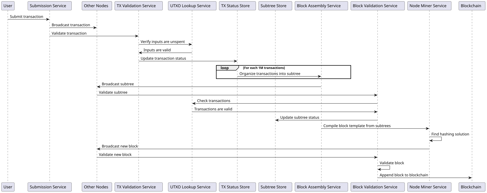

# Teranode Overall System Design

## Index

1. [Introduction](#1-introduction)
2. [Key Concepts and Innovations](#2-key-concepts-and-innovations)
    - [2.1 Horizontal Scalability](#21-horizontal-scalability)
    - [2.2 Subtrees](#22-subtrees)
    - [2.3 Extended Transactions](#23-extended-transactions)
    - [2.4 Unbounded Block Size](#24-unbounded-block-size)
    - [2.5 Comparison with BTC](#25-comparison-with-btc)
3. [System Architecture Overview](#3-system-architecture-overview)
4. [Data Model and Propagation](#4-data-model-and-propagation)
    - [4.1 Bitcoin Data Model](#41-bitcoin-data-model)
    - [4.2 Teranode Data Model](#42-teranode-data-model)
    - [4.3 Network Behavior](#43-network-behavior)
5. [Node Workflow](#5-node-workflow)
6. [Scalability and Performance](#6-scalability-and-performance)
7. [Impact on End-Users and Developers](#7-impact-on-end-users-and-developers)
8. [Glossary of Terms](#8-glossary-of-terms)
9. [End-to-End Architecture Reference](#9-end-to-end-architecture-reference)
    - [9.1 The Transaction and Block Journey](#91-the-transaction-and-block-journey)
    - [9.2 Reorganization, Conflicts and Catchup](#92-reorganization-conflicts-and-catchup)
    - [9.3 Synchronous vs Asynchronous Boundaries](#93-synchronous-vs-asynchronous-boundaries)
10. [Related Resources](#10-related-resources)

## 1. Introduction

In the early stages of Bitcoin's development, a block size limit of 1 megabyte per block was introduced as a temporary measure. This limit effectively restricts the network's capacity to approximately 3.3 to 7 transactions per second. As Bitcoin's adoption has expanded, this constraint has increasingly led to transaction processing bottlenecks, causing delays and higher transaction fees. These issues have highlighted the critical need for scalable solutions within the Bitcoin network.

Teranode, the next evolution of the BSV node software, and developed by the BSV Association, addresses the challenges of vertical scaling by instead spreading the workload across multiple machines. This horizontal scaling approach, coupled with an unbound block size, enables network capacity to grow with increasing demand through the addition of cluster nodes, allowing for Bitcoin scaling to be truly unbounded.

Teranode provides a robust node processing system for Bitcoin designed to handle over 1M transactions per second, while strictly adhering to the Bitcoin whitepaper.

Teranode is responsible for:

- Validating and accepting or rejecting received transactions.

- Building and assembling new subtrees and blocks.

- Validating and accepting or rejecting received or found subtrees and blocks.

- Adding found blocks to the Blockchain.

- Managing Coinbase transactions and their spendability.

## 2. Key Concepts and Innovations

### 2.1 Horizontal Scalability

While BTC relies on vertical scaling—increasing the power of individual nodes—Teranode embraces horizontal scalability through its microservices architecture. This fundamental difference allows Teranode to overcome BTC's inherent limitations:

1. **Scalability Approach**:

    - BTC: Increases processing power of single nodes (vertical scaling).
    - Teranode: Distributes workload across multiple machines (horizontal scaling).

2. **Transaction Processing**:

    - BTC: Limited to ~7 transactions per second due to 1MB block size and 10-minute block time.
    - Teranode: Designed to process over 1 million transactions per second, with potential for further increase.

3. **Resource Utilization**:

    - BTC: Requires increasingly powerful (and expensive) hardware for each node.
    - Teranode: Can add multiple commodity machines to increase capacity cost-effectively.

4. **Flexibility**:

    - BTC: Monolithic architecture makes updates and improvements challenging.
    - Teranode: Microservices allow independent scaling and updating of specific functions (e.g., transaction validation, transaction propagation).

5. **Network Resilience**:

    - BTC: Failure of a node can significantly impact network capacity.
    - Teranode: Distributed architecture ensures continued operation even if some nodes fail.

### 2.2 Subtrees

Subtrees are an innovation aimed at improving scalability and real-time processing capabilities of the blockchain system. A subtree acts as an intermediate data structure to hold batches of transaction IDs (including metadata) and their corresponding Merkle root. Each subtree computes its own Merkle root, which is a single hash representing the entire set of transactions within that subtree.

Subtrees are broadcast every second (assuming a baseline throughput of 1M transactions per second), making data propagation more continuous. Broadcasting subtrees at this high frequency allows receiving nodes to validate batches quickly and continuously, essentially "pre-approving" them for inclusion in a block.
When a block is found, its validation is expedited due to the continuous processing of subtrees.

This proactive approach with subtrees enables the network to handle a significantly higher volume of transactions while maintaining quick validation times. It also allows nodes to utilize their processing power more evenly over time, rather than experiencing idle times between blocks.

### 2.3 Extended Transactions

Teranode uses the BSV Extended Transaction format, which includes additional metadata to facilitate processing. This format adds a marker to the transaction format and extends the input structure to include the previous locking script and satoshi outputs.

### 2.4 Unbounded Block Size

Unlike the fixed 1MB block size in the original Bitcoin implementation, Teranode BSV features an unbounded block size. This allows for potentially unlimited transactions per block, increasing throughput and reducing transaction fees.

### 2.5 Comparison with BTC

| Feature                               | BTC                                                                                                                                                                                            | Teranode BSV                                                                                                                                                                                                                                                                          |
|---------------------------------------|------------------------------------------------------------------------------------------------------------------------------------------------------------------------------------------------|---------------------------------------------------------------------------------------------------------------------------------------------------------------------------------------------------------------------------------------------------------------------------------------|
| **Transactions**                      | Standard Bitcoin transaction model.                                                                                                                                                            | Adopts an extended format with extra metadata, improving processing efficiency.                                                                                                                                                                                                       |
| **SubTrees**                          | Not used.                                                                                                                                                                                      | A novel concept in Teranode, serving as an intermediary for holding transaction IDs and their Merkle roots.     Each subtree contains 1 million transactions. Subtrees are broadcast every second.   Broadcast frequently for faster and continuous data propagation. |
| **Blocks**                            | Transactions are grouped into blocks. Direct transaction data is stored in the block. Each block is linked to the previous one by a cryptographic hash, forming a secure, chronological chain. | In the BSV blockchain, Bitcoin blocks are stored and propagated using an abstraction using subtrees of transaction IDs. This method significantly streamlines the validation process and synchronization among miners, optimizing the overall efficiency of the network.              |
| **Block Size**                        | Originally capped at 1MB (1 Megabyte), restricting transactions per block.                                                                                                                     | Current BSV expands to 4GB (4 Gigabytes), increasing transaction capacity.   Teranode removes the size limit, enabling limitless transactions per block.                                                                                                                      |
| **Processed Transactions per second** | 3.3 to 7 transactions per second.                                                                                                                                                              | Designed for a minimum of **1 million transactions per second** (100,000 x faster than BTC).                                                                                                                                                                                           |
| **Scalability Approach**              | Vertical scaling: Increases processing power of individual nodes. Limited by hardware capabilities of single machines. Monolithic architecture makes updates challenging.                      | Horizontal scaling: Distributes workload across multiple machines using a microservices architecture. Allows independent scaling of specific functions (e.g., transaction validation, transaction propagation). More cost-effective and flexible, with higher resilience to node failures.     |

## 3. System Architecture Overview

The Teranode architecture is designed as a collection of microservices that work together to provide a decentralized, scalable, and secure blockchain network. The node is modular, allowing for easy integration of new services and features.

Key components of the Teranode architecture include:

1. Teranode Core Services:

    - Asset Server
    - Propagation Service
    - Validator Service
    - Subtree Validation Service
    - Block Validation Service
    - Block Assembly Service
    - Blockchain Service
    - Alert Service

2. Overlay Services:

    - Block Persister Service
    - UTXO Persister Service
    - P2P Service
    - Legacy Service
    - RPC Service
    - Pruner Service

3. Stores:

    - TX and Subtree Store
    - UTXO Store

4. Other Components:

    - Kafka Message Broker
    - Miners

For an introduction to each service, please check the [Teranode Microservices Overview](teranode-microservices-overview.md).

## 4. Data Model and Propagation

### 4.1 Bitcoin Data Model

In the original Bitcoin model:

- Transactions are broadcast and included in blocks as they are found.
- Blocks contain all transaction data for the transactions included.

### 4.2 Teranode Data Model

The Teranode data model introduces:

- [Extended Transactions](../datamodel/transaction_data_model.md): Include additional metadata to facilitate processing.
- [Subtrees](../datamodel/subtree_data_model.md): Contain lists of transaction IDs and their Merkle root.
- [Blocks](../datamodel/block_data_model.md): Contain lists of subtree identifiers, not transactions.

The main differences can be seen in the table below:

| Feature | BTC | BSV (pre-Teranode) | Teranode BSV |
|---------|-----|-------------------|---------------|
| **Transactions** | Standard Bitcoin transaction model. | Standard Bitcoin transaction model with restored original op_codes. | Adopts an extended format with extra metadata, improving processing efficiency. |
| **SubTrees** | Not used. | Not used. Traditional block propagation. | A novel concept in Teranode, serving as an intermediary for holding transaction IDs and their Merkle roots.    Each subtree contains 1 million transactions. Subtrees are broadcast every second.   Broadcast frequently for faster and continuous data propagation. |
| **Blocks** | Transactions are grouped into blocks. Direct transaction data is stored in the block. Each block is linked to the previous one by a cryptographic hash, forming a secure, chronological chain. | Same as BTC, with increased block size capacity. | In the BSV blockchain, Bitcoin blocks are stored and propagated using an abstraction using subtrees of transaction IDs. This method significantly streamlines the validation process and synchronization among miners, optimizing the overall efficiency of the network. |
| **Block Size** | Originally capped at 1MB (1 Megabyte), restricting transactions per block. | Increased to 2GB, then to 4GB block size limit. | Current BSV expands to 4GB (4 Gigabytes), increasing transaction capacity.   Teranode removes the size limit, enabling limitless transactions per block. |
| **Processed Transactions per second** | 3.3 to 7 transactions per second. | Up to several thousand transactions per second. | Designed for a minimum of **1 million transactions per second** (100,000 x faster than BTC). |
| **Mempool** | Maintains a memory pool of unconfirmed transactions waiting to be included in blocks. Size limited by node memory. | Similar to BTC, but with larger capacity due to increased memory limits. | No traditional mempool. Transactions are immediately processed and organized into subtrees. Continuous validation and subtree creation replaces mempool functionality. |

&nbsp;

### 4.3 Network Behavior

- Transactions are broadcast network-wide, and each node further propagates the transactions.
- Nodes broadcast subtrees to indicate prepared batches of transactions for block inclusion.
- When a block is found, its validation is expedited due to the continuous processing of subtrees.

## 5. Node Workflow

1. **Transaction Submission**: Transactions are received by all nodes via a broadcast service.
2. **Transaction Validation**: The Validator Service checks each transaction against network rules.
3. **Subtree Assembly**: The Block Assembly Service organizes validated transactions into subtrees.
4. **Subtree Validation**: The Subtree Validation Service validates received subtrees.
5. **Block Assembly**: The Block Assembly Service compiles block templates consisting of validated subtrees.
6. **Block Validation**: When a valid block is found, it's sent to the Block Validation Service for final checks before being appended to the blockchain.

## 6. Scalability and Performance

Teranode achieves high throughput through:

- **Horizontal scaling**: Spreading workload across multiple machines.
- **Unbounded block size**: Allowing for potentially unlimited transactions per block.
- **Subtree processing**: Enabling continuous validation of transaction batches.
- **Extended transaction format**: Facilitating more efficient transaction processing.

## 7. Impact on End-Users and Developers

The Teranode architecture offers several benefits:

- **Higher transaction throughput**: Enabling more transactions per second.
- **Lower fees**: Due to increased capacity and efficiency.
- **Faster transaction confirmation**: Through continuous subtree processing.
- **Improved scalability**: Allowing the network to grow with demand.

## 8. Glossary of Terms

- **Subtree**: An intermediate data structure holding batches of transaction IDs and their Merkle root.
- **Extended Transaction**: A transaction format that includes additional metadata for efficient processing.
- **UTXO**: Unspent Transaction Output, representing spendable coins in the Bitcoin system.
- **Merkle root**: A single hash representing a set of transactions in a subtree or block.

Please check the [Teranode BSV Glossary](../../references/glossary.md) for more terms and definitions.

## 9. End-to-End Architecture Reference

The sections above, the [Teranode Microservices Overview](teranode-microservices-overview.md), and the individual service docs each cover part of the system in detail. None of them, on its own, walks the full path a transaction or block takes from ingress to long-term storage, or says which document to open for a given stage. This section is that index — connective tissue, not a replacement for the detailed docs it links to.

### 9.1 The Transaction and Block Journey

| Stage | Primary service(s) | Detail doc(s) |
|---|---|---|
| Transaction ingress (gRPC/HTTP/UDP) | Propagation Service | [Propagation](../services/propagation.md) |
| Consensus validation, UTXO create/spend | Validator Service | [Validator](../services/validator.md) |
| Subtree assembly and announcement, block template, mining candidates | Block Assembly Service | [Block Assembly](../services/blockAssembly.md) |
| Subtree validation (subtrees received from peers) | Subtree Validation Service | [Subtree Validation](../services/subtreeValidation.md) |
| Block and subtree ingress from peers (Kafka hand-off to validation) | P2P Service | [P2P](../services/p2p.md) |
| Peer discovery, connection management, message transport | P2P Service | [P2P](../services/p2p.md) |
| Block validation | Block Validation Service | [Block Validation](../services/blockValidation.md) |
| Chain state, FSM, reorg coordination | Blockchain Service | [Blockchain](../services/blockchain.md), [State Management](stateManagement.md) |
| Long-term block/tx persistence | Block Persister Service | [Block Persister](../services/blockPersister.md) |
| UTXO set snapshotting | UTXO Persister Service | [UTXO Persister](../services/utxoPersister.md) |
| UTXO pruning (bounding store growth) | Pruner Service | [Pruner](../services/pruner.md) |
| Bridging to pre-Teranode BSV nodes | Legacy Service | [Legacy](../services/legacy.md) |
| External data access (HTTP/WebSocket, Bitcoin RPC) | Asset Server, RPC Service | [Asset Server](../services/assetServer.md), [RPC](../services/rpc.md) |
| Network-wide alerts, freeze/unfreeze, ban/invalidate | Alert Service | [Alert](../services/alert.md) |
| Service startup/dependency ordering | Daemon | [Daemon Reference](../../references/teranodeDaemonReference.md) |

Blocks and subtrees announced by peers enter through the P2P Service, which hands them to Block Validation and Subtree Validation asynchronously over Kafka (`kafka_blocksConfig`, `kafka_subtreesConfig`). Blocks also enter through the Legacy Service from pre-Teranode peers; that path calls Block Validation directly rather than going through Kafka, but joins the same validation stage.

Transactions normally enter via the Propagation Service, but the RPC Service's `sendrawtransaction` calls the Validator directly, bypassing Propagation and its Kafka hand-off, and applies its own absurd-fee ceiling that no other ingress path enforces. The Legacy Service is a third transaction ingress.

For the storage layer underneath these services, see the [Blob Store](../stores/blob.md) and [UTXO Store](../stores/utxo.md) docs, and for the messaging layer see [Kafka](../kafka/kafka.md).

### 9.2 Reorganization, Conflicts and Catchup

Chain reorganization and double-spend/conflict handling are cross-cutting: they involve Block Validation, the Blockchain Service's FSM, Subtree Validation, and the UTXO Store together, rather than a single service. Rather than duplicate that detail here:

- [Understanding Double Spends and Conflict Resolution](understandingDoubleSpends.md) covers first-seen detection, conflicting-transaction tracking, and the five reorg phases (mark original as conflicting → unspend original → process double spend → update double-spend status → cleanup).
- [State Management in Teranode](stateManagement.md) covers the FSM states (`Idle`, `Running`, `CatchingBlocks`) that drive catchup after a missing parent block, and how services wait on state transitions.

#### 9.2.1 Reorg Coordination Order

A reorg changes state in three places: the chain tip in the Blockchain service, the mined status of transactions in the UTXO store, and the unmined transaction set in Block Assembly. Double-spend resolution in the UTXO store is part of the third. This section gives the order of these changes. It also states what is atomic and what is not.

##### Order of Steps

1. **Blockchain changes the tip.** `StoreBlock` writes the block row. The best block is the valid block with the most `chain_work` (`GetBestBlockID` orders by `chain_work DESC, peer_id ASC, id ASC`), so the tip moves when the row commits. For a block that does not extend the current best, the insert and the `on_main_chain` repair run in one SQL transaction. `InvalidateBlock` and `RevalidateBlock` can also move the tip. No depth limit applies at this step.
2. **Blockchain publishes the change.** After the commit, `AddBlock` publishes the block on the `blocks-final` Kafka topic (valid blocks only), and the Legacy service relays it to legacy peers. Then `AddBlock` sends a `Block` notification to subscribers over gRPC.
3. **Block Validation records mined status.** `setTxMined` runs in the background for each validated block. It asks the Blockchain service whether the block is on the current chain (`CheckBlockIsInCurrentChain`). Then it writes the block IDs and `unmined_since` of the block's transactions through `model.UpdateTxMinedStatus`, and sets `mined_set` on the block. This job does not run for a block that arrives with a pre-assigned ID: a quick-validated block (`commitBlock`), or a block at or below the highest checkpoint (`buildAddBlockOpts`). Block Validation writes the mined status of these transactions during validation, before step 1, and `AddBlock` stores the block with `mined_set` already true.
4. **Block Assembly reads the tip.** The notification wakes the Block Assembly event loop, which runs `processNewBlockAnnouncement` on one goroutine. This function does not use the hash in the notification. It calls `GetBestBlockHeader`, so it always acts on the tip from step 1, and many notifications fold into one pass. It selects one path:
    - **Move up**: the new tip extends the Block Assembly tip by one block. Block Assembly fetches no locators and calls `MoveForwardBlock` directly. This is the path for a normal new block.
    - For all other cases, Block Assembly finds the common ancestor from two block locators, then selects one of the paths below.
    - **Catch-up**: there are no blocks to move back.
    - **Reorg in place**: the default when there are blocks to move back.
    - **Reset**: the depth reaches the UTXO retention; or the depth reaches coinbase maturity above height 1000; or a moved-back block is invalid; or the in-place reorg fails (`reorgNeedsReset`, `handleReorg`).
5. **Block Assembly waits for Block Validation.** On the catch-up, reorg and reset paths, Block Assembly does not change the UTXO store until step 3 is complete. The move-up path waits only in some cases:
    - Move up waits for `mined_set` on the block only when the block carries conflicting transactions (`waitForBlockBeingMined`, before `ProcessConflicting`). Otherwise it does not wait, and it can write the coinbase UTXOs of the block (`processCoinbaseUtxos`) before step 3 is complete.
    - Catch-up waits for `mined_set` on the last block (`waitForBlockBeingMined`, 300-second limit). When the limit expires, Block Assembly logs the error, increments `teranode_blockassembly_processing_stuck_total{reason="catchup"}`, and tries again on the next notification or reconcile.
    - Reorg in place and reset wait until no block has `mined_set` false (`WaitForPendingBlocks`). This wait retries with no limit.
6. **Block Assembly moves blocks back.** The subtree processor runs `reorgBlocks` on its own goroutine. For each block that leaves the main chain, `moveBackBlock` returns the block's transactions to block assembly. If the block carried `ConflictingNodes`, `ReverseProcessConflicting` undoes the double-spend swap that the block applied. Transactions that are also in a block that moves forward are not reversed.
7. **Block Assembly moves blocks forward.** For each block that joins the main chain, `moveForwardBlock` removes the block's transactions from block assembly. If the block carries conflicting transactions, `ProcessConflicting` runs the five-phase swap in [Understanding Double Spends](understandingDoubleSpends.md#3-chain-reorganization-handling).
8. **Block Assembly records longest-chain status.** `reorgBlocks` calls `MarkTransactionsOnLongestChain` to clear `unmined_since` on transactions that are now mined on the main chain, and to set it on transactions that are not. Then Block Assembly stores its new tip (`setBestBlockHeader`) and persists it (`SetState`).

##### What the Order Guarantees

- Block Assembly never starts a reorg before the Blockchain service commits the new tip. A notification only wakes Block Assembly; Block Assembly reads the tip itself in step 4.
- Block Assembly does not change the UTXO store for a reorg before Block Validation sets `mined_set` on the affected blocks (step 5). For catch-up, this wait has a 300-second limit, as step 5 describes.
- Two services write `unmined_since`: Block Validation in step 3, and Block Assembly in steps 6 to 8. Step 5 makes the Block Assembly writes come after the Block Validation writes.
- At runtime, only Block Assembly calls `ProcessConflicting` and `ReverseProcessConflicting`: in steps 6 and 7, and in the startup replay below. Double-spend resolution does not run apart from the Block Assembly reorg. The Validator and Subtree Validation mark a transaction as conflicting when they first detect a double spend. That is detection, not the reorg swap.
- Block Assembly runs a reconcile at startup, and when block generation waits too long for the tip (`triggerReconcile`). A reconcile runs step 4 again, so a lost notification does not leave Block Assembly on an old tip.

##### What Is Not Atomic

- **The UTXO rollback to the fork point is not one atomic operation.** Steps 6 to 8 write to the UTXO store block by block. Each `ProcessConflicting` and `ReverseProcessConflicting` call records a write-ahead intent before its first write (`BeginConflictIntent`), and undoes its own partial writes if it fails in the process. `MarkTransactionsOnLongestChain` has no write-ahead intent. If the in-place reorg fails, Block Assembly restores its in-memory state and falls back to a reset. The UTXO writes for blocks that the failed reorg already processed stay, and the reset rebuilds block assembly from the UTXO store.
- **The services disagree on the tip for a period.** From step 2 to the end of step 8, the Blockchain service and legacy peers have the new tip, but Block Assembly still has the old tip. `GetMiningCandidate` returns an empty candidate on the new tip only in the `blockchainSubscription` and `movingUp` states. In the `reorging`, `reconciling` and `resetting` states, the candidate uses the Block Assembly tip, which is the old tip until step 8 completes.

##### Restart After a Crash in a Reorg

On start, Block Assembly does these steps in sequence:

1. It loads its persisted tip (`initState`). After a crash in a reorg, this is the tip before the reorg.
2. It waits for pending blocks (`WaitForPendingBlocks`).
3. It replays each pending write-ahead intent, or heals the intent if its block changed chain since the crash (`replayPendingConflictIntents`).
4. It loads unmined transactions (`loadUnminedTransactions`).
5. It starts its listeners and runs a reconcile, which runs the reorg again from the persisted tip.

The code states that `ProcessConflicting` and `ReverseProcessConflicting` are idempotent under replay. This document does not verify an end-to-end second run of a half-applied reorg.

The offline `rewindblockchain` tool also writes to the UTXO store. It requires a stopped node, so it is outside this order.

### 9.3 Synchronous vs Asynchronous Boundaries

Services communicate through a mix of synchronous gRPC calls and asynchronous Kafka topics; the [Interaction Patterns](teranode-microservices-overview.md#6-interaction-patterns) and [Kafka Message Broker](teranode-microservices-overview.md#51-kafka-message-broker) sections describe which hops use which mechanism.

One open documentation gap: there is no stated **maximum** synchronous call-chain length across services — a guardrail against runaway synchronous fan-out during a single protocol operation. This document deliberately does not invent one; a maximum like that is an architectural decision the team should make and justify explicitly, not a number a doc should assert unilaterally.

As an observation only (not a policy): tracing the current pipeline, the longest synchronous, in-request chain occurs when Block Validation checks a block's subtrees and encounters transactions it hasn't validated yet — Block Validation → Subtree Validation → Validator → Block Assembly — four services deep before the outermost call returns. The last hop exists because validated transactions are added to block assembly while the FSM is `Running` (`services/subtreevalidation/check_block_subtrees.go` computes `addTXToBlockAssembly` from the FSM state and the request's `keep_block_assembly_handoff` flag, and the Validator's `Store` call into Block Assembly blocks on the batch completing). A short catch-up that started from `Running` keeps this hop while `CatchingBlocks`, within `blockvalidation_catchup_keep_block_assembly_max_blocks` (default 6); other catch-up runs skip it and the chain is three deep. The Validator also reaches the Blockchain Service synchronously on this path, for median-time-past.

The Subtree Validation → Validator boundary is an in-process call rather than a network hop under `useLocalValidator`, which the committed `settings.conf` enables by default: with that default, the daemon's `GetValidatorClient` hands every consumer — Propagation, the shared Subtree-Validation/Block-Validation startup path, and Legacy — an in-process `*Validator` wired directly to the shared UTXO store instead of a gRPC stub. The logical dependency chain is unchanged either way, and the Validator → Block Assembly hop stays a network call regardless. This is noted here as a data point for that future decision, not as an established rule or limit.

## 10. Related Resources

- [Teranode Microservices Overview](teranode-microservices-overview.md)
- [Extended Transactions](../datamodel/transaction_data_model.md): Include additional metadata to facilitate processing.
- [Subtrees](../datamodel/subtree_data_model.md): Contain lists of transaction IDs and their Merkle root.
- [Blocks](../datamodel/block_data_model.md): Contain lists of subtree identifiers, not transactions.
