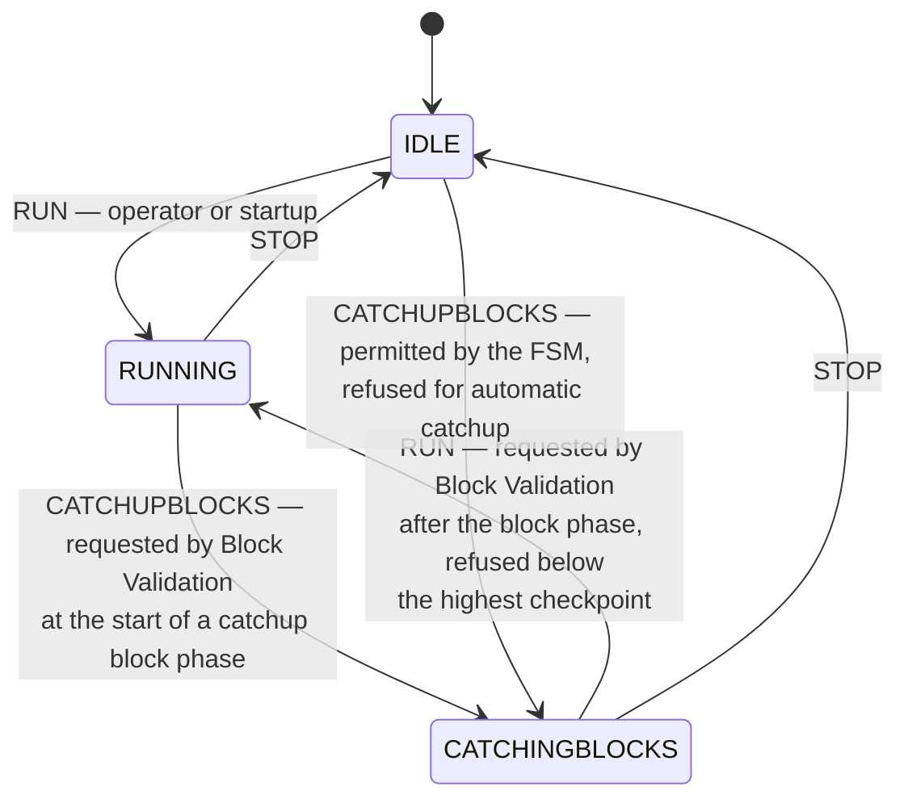
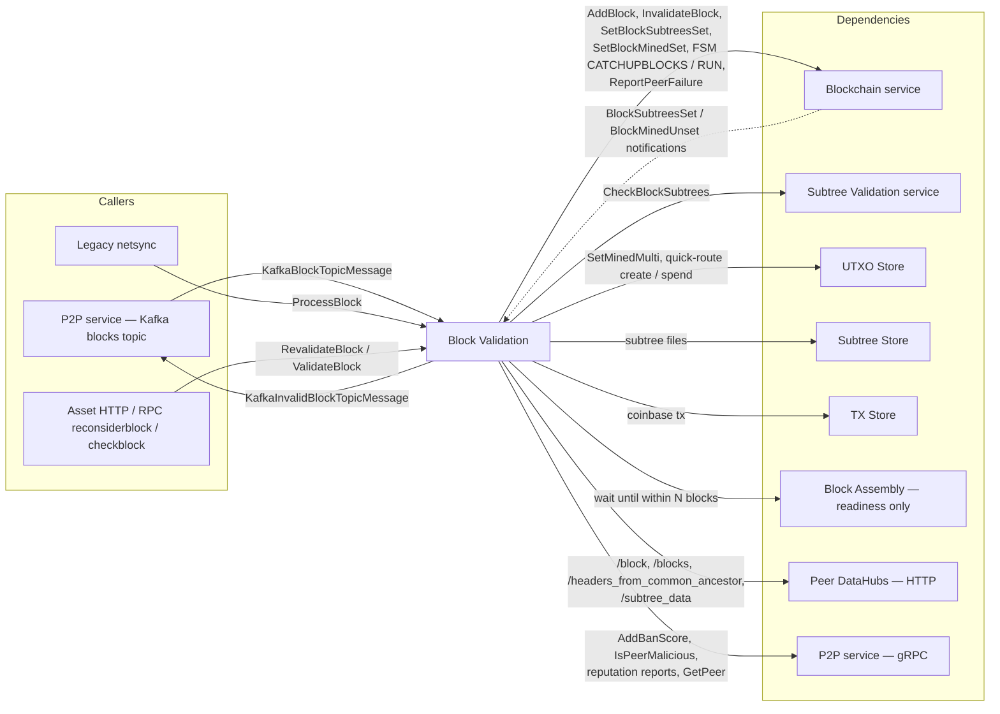
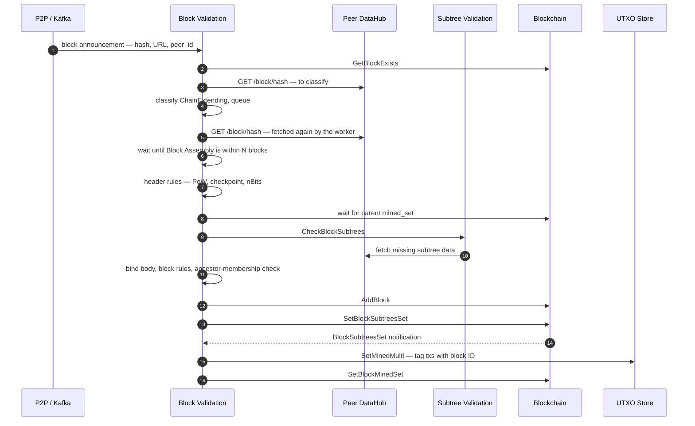
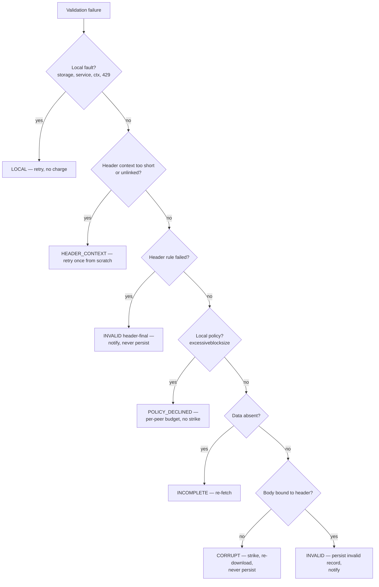
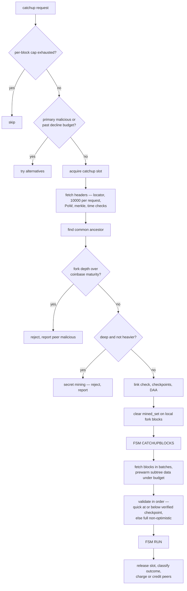

# Spec: services/blockvalidation

**Status:** Draft — generated, awaiting human review
**Last generated:** 2026-10-14
**Sources consulted:** package doc comments at the top of `Server.go` and `Interface.go`; RPC and message comments in `blockvalidation_api/blockvalidation_api.proto`; the `longdesc` text of every setting in `settings/blockvalidation_settings.go` and the defaults in `settings/settings.go`; `catchup.md`; `docs/topics/services/blockValidation.md`; `docs/references/services/blockvalidation_reference.md`; the Kafka block and invalid-block message definitions in `util/kafka/kafka_message/kafka_messages.proto`; test function names and doc comments across the package's `*_test.go` files; deep-dive reads of `Server.go`, `BlockValidation.go`, `catchup.go`, `catchup_get_block_headers.go`, `catchup_difficulty.go`, `catchup_status.go`, `get_blocks.go`, `quick_validate.go`, `quick_validate_bind.go`, `skip_unspendable.go`, `block_priority.go`, `fork_manager.go`, `peer_metrics_helpers.go`, `peer_selection.go`, `peer_cache_bypass.go`, `metrics.go`, `catchup/circuit_breaker.go`, `catchup/header_chain_cache.go`, `catchup/helpers.go`; `model/Block.go`, `model/checkpoint.go`, `model/block_coinbase_common_rules.go`, `model/update-tx-mined.go`; the blockchain service FSM (`services/blockchain/fsm.go`) and its `InvalidateBlock` / `RevalidateBlock` store operations; the legacy netsync caller (`services/legacy/netsync/handle_block.go`). Consensus rules were audited against the bitcoin-sv reference node (local tree at HEAD 879fc8b42): `validation.cpp` (`CheckBlock`, `ContextualCheckBlockHeader`, `ContextualCheckBlock`, `ContextualCheckTransaction`, `CheckCoinbase`, `CheckRegularTransaction`, `ConnectBlock`), `pow.cpp`, `verify_script_flags.cpp`, `policy/policy.h` and `consensus/consensus.h`.
**Requirement-ID prefix:** `BV`

> The `catchup/` subpackage will carry its own `spec.md`. This spec states the catchup contract only as it is visible at the Block Validation service boundary.

---

## Status and Scope

This document defines the contract that the Block Validation service MUST conform to. It covers behaviour visible to callers and observable state: which blocks are accepted onto the chain, which are rejected and how, what is persisted, and what is reported about the peers that served them. It does **not** describe implementation mechanisms; those live in [Non-Normative Notes](#non-normative-notes). Known divergences between this spec and the current implementation are listed in [Conformance Gaps](#conformance-gaps); unresolved design questions are listed in [Open Questions](#open-questions).

Conformance is judged against requirements identified by stable IDs of the form `BV-<CATEGORY>-<NNN>`. Acceptance criteria live in the [Conformance Test Matrix](#conformance-test-matrix).

The service sits between block announcement (P2P, legacy netsync, Block Assembly's own solutions arriving through the Blockchain service) and the Blockchain service's chain state. Script and transaction-level validation of a block's transactions is delegated to the Subtree Validation service. Block Validation owns header rules, body-to-header binding, block-level consensus rules, the commit sequence, chain catchup, and peer accountability for block delivery.

---

## Terminology

- **Announcement** — A notice that a block with a given hash exists and can be fetched from a given base URL. Arrives via the `BlockFound` RPC or the Kafka blocks topic.
- **Base URL** — Where the block body and subtree data are fetched from. Either an `http`/`https` DataHub URL of a peer, or the literal `legacy`, meaning the block arrived through the legacy Bitcoin wire protocol and its data is already local.
- **Bound body** — A block body whose content has been proven to hash to the header's merkle root. Only a bound body can be the subject of a consensus verdict.
- **Corrupt** — A body that is not bound to its header (merkle mismatch, misplaced coinbase placeholder, duplicate transaction, inconsistent subtree shape). Corruption says nothing about the block the header names; the same hash may have an honest body elsewhere. Signalled by `ERR_BLOCK_CORRUPT`.
- **Invalid** — A consensus failure of a header or of a bound body. Signalled by `ERR_BLOCK_INVALID`.
- **Incomplete** — Required data was absent (missing coinbase, missing parent transaction data). Re-fetchable; not a verdict. Signalled by `ERR_BLOCK_INCOMPLETE`.
- **Header context** — The run of previous headers needed to evaluate contextual header rules (median-time-past, expected difficulty). A run too short or unlinked to carry those rules is a local data problem, signalled by `ERR_BLOCK_HEADER_CONTEXT`, not a verdict.
- **Policy decline** — Refusal on this node's local policy (`excessiveblocksize`), not on consensus. Signalled by `ERR_BLOCK_POLICY_DECLINED`.
- **Poison** — Persisting a block record with the invalid flag set. A poisoned hash is never re-validated except through `RevalidateBlock`.
- **Strike** — A ban-score increment against the serving peer, delivered through the P2P service.
- **Optimistic mining** — Adding a block to the chain after its subtrees validate but before the remaining block-level checks complete, so that mining can start on it sooner. The remaining checks run in the background.
- **subtrees_set / mined_set** — Two per-block flags in the Blockchain store. `subtrees_set` records that the block passed validation and its subtree files exist. `mined_set` records that every transaction in the block has been tagged in the UTXO store with this block's ID.
- **Catchup** — Fetching and validating a run of blocks from one peer when an announced block's parent is not stored locally.
- **Common ancestor** — The newest block shared by the local chain and the peer's offered header chain.
- **Fork depth** — Local best height minus common-ancestor height.
- **Quick validation** — A reduced validation route for blocks at or below a verified checkpoint, which trusts the checkpoint for script and fee validity and still enforces body binding and coinbase rules.
- **Highest hardcoded checkpoint** — The greatest height in the chain configuration's compiled-in checkpoint list. Distinct from the operator catchup-checkpoint override.
- **Header-proven** — A claim by the legacy netsync caller that a block's hash lies at or below a pinned checkpoint hash in an internally linked header run.
- **Floater** — A block whose transactions spend a parent that is not recorded in the UTXO store, or not recorded as mined.
- **Sweep** — The periodic background pass that completes `subtrees_set` and `mined_set` for stored blocks left incomplete.

---

## Normative Requirements

### Ingress Contract (`BV-INGRESS-NNN`)

**BV-INGRESS-001.** The service SHALL accept block announcements via the `BlockFound` RPC and via the Kafka topic configured by `kafka_blocksConfig`. Both paths SHALL feed the same processing pipeline and produce the same outcome for the same announcement.

**BV-INGRESS-002.** A `BlockFound` request whose `hash` is not exactly 32 bytes MUST be rejected with `ERR_PROCESSING`. No work is queued.

**BV-INGRESS-003.** An announcement of a block already stored in the Blockchain store, whether stored valid or stored invalid, SHALL be acknowledged as success with no further fetch or validation work. A stored-invalid block is re-examined only through `RevalidateBlock` (BV-REVALIDATE-001).

**BV-INGRESS-004.** An announcement whose base URL is neither an `http`/`https` URL nor the literal `legacy` MUST be rejected with `ERR_PROCESSING` and message `invalid baseURL - not a valid http/https URL`. On `BlockFound` this check runs after the call is acknowledged, so the caller sees the error only with `wait_to_complete = true`. On the Kafka path the message is `invalid URL scheme '<scheme>' - expected http or https`, and the message is committed with a peer failure reported. `ProcessBlock` additionally MUST reject a non-`legacy` base URL that fails the shared URL validator with `ERR_INVALID_ARGUMENT` and message `invalid base URL`.

**BV-INGRESS-005.** When `BlockFound` is called with `wait_to_complete = true`, the RPC MUST NOT return until the block has been validated and either committed or rejected, and MUST return the validation outcome. A return before that point is permitted only if the request's context is cancelled.

**BV-INGRESS-006.** The number of announcements accepted by `BlockFound` but not yet placed on the internal block-found buffer (sized by `blockvalidation_blockFoundCh_buffer_size`, default 1000) MUST be bounded. A full buffer MAY block the caller; it MUST NOT accumulate unbounded pending work.

**BV-INGRESS-007.** The Kafka block consumer MUST NOT begin consuming until the Blockchain FSM has left `IDLE` for the first time after service start.

**BV-INGRESS-008.** A Kafka block message that cannot be decoded SHALL be committed and dropped.

**BV-INGRESS-009.** A Kafka block message whose processing fails for a local or transient reason (storage, service, threshold-exceeded, context-cancelled, external) MUST NOT be committed, so that it is redelivered. A message whose processing fails for any other reason SHALL be committed, and the failure SHALL be reported against the announcing peer to the Blockchain service as a `block` peer failure.

**BV-INGRESS-010.** The announcing peer's identifier (`peer_id`) SHALL be carried through every stage of processing and SHALL be the identity used for every peer-accountability action in BV-PEER. The service's Go client MUST allow a caller to supply `peer_id` to `BlockFound`.

**BV-INGRESS-011.** `ProcessBlock` MUST reject a `block` payload that does not deserialize, with `ERR_PROCESSING` and message `failed to create block from bytes`.

**BV-INGRESS-012.** When `ProcessBlock` is called with `height = 0`, the service SHALL derive the height as the stored parent's height + 1. If the parent cannot be read the call MUST fail with `ERR_SERVICE_ERROR`. If the height is still 0 the call MUST fail with `ERR_PROCESSING` and message `invalid height: 0`.

**BV-INGRESS-013.** When `ProcessBlock` is called with `block_id ≠ 0`, that ID SHALL be the ID under which the block is stored, whether it is stored valid or stored invalid. `block_id = 0` means the Blockchain service assigns the ID.

**BV-INGRESS-014.** `ProcessBlock` with an empty `base_url` SHALL treat the block as arriving from `legacy`.

**BV-INGRESS-015.** A peer-claimed block height MUST equal the stored parent's height + 1, or be 0 (meaning "derive"). Any other claim MUST be rejected with `ERR_BLOCK_INVALID` and message `rejecting block with peer-inconsistent height`.

**BV-INGRESS-016.** When an announced block's parent is not stored, the service SHALL hand the block to catchup (BV-CATCHUP-001) instead of validating it directly.

**BV-INGRESS-017.** A synchronous caller — `ProcessBlock`, or `BlockFound` with `wait_to_complete = true` — MUST NOT receive success for a block that was not committed. When the parent is missing, the call MUST return a retryable `ERR_SERVICE_ERROR`, whether or not the block was also handed to catchup.

**BV-INGRESS-018.** Before validating a block at height H, the service SHALL wait until Block Assembly's height is within `blockvalidation_maxBlocksBehindBlockAssembly` (default 20) blocks of H.

**BV-INGRESS-019.** If the parent block is itself still being validated or committed, the service SHALL wait for that to finish before validating the child. The wait MUST honour the caller's context.

### Queue and Prioritisation Contract (`BV-QUEUE-NNN`)

**BV-QUEUE-001.** The service SHALL classify every announced block whose parent is stored into exactly one of three priorities:

- **ChainExtending** — the parent is the current best block.
- **NearFork** — not ChainExtending, and parent height + 1 ≥ best height − near-fork threshold.
- **DeepFork** — all others, and any block whose classification fails.

**BV-QUEUE-002.** The near-fork threshold SHALL be `blockvalidation_near_fork_threshold` when it is > 0, and `CoinbaseMaturity / 2` otherwise. The comparison in BV-QUEUE-001 MUST be computed without unsigned wraparound: when best height < threshold, no block with a stored parent is DeepFork on height grounds.

**BV-QUEUE-003.** Queued blocks SHALL be dequeued in order of effective priority, then lower height first, then arrival order.

**BV-QUEUE-004.** No block may wait indefinitely behind higher-priority blocks. A block that has waited more than 1 minute SHALL have its effective priority raised one level for each further minute. A block skipped more than 10 times SHALL be promoted to ChainExtending. Ageing and promotion SHALL take effect at the next dequeue, whether or not the queue was modified in between.

**BV-QUEUE-005.** A second announcement of a hash already in the queue MUST NOT create a second entry. It SHALL be recorded as an additional source for that hash. Additional sources per hash MUST be bounded at 3, the same bound as catchup alternatives (BV-CATCHUP-022).

**BV-QUEUE-006.** When fetching a queued block from its announcer fails, the service SHALL try the hash's additional sources before giving up on the hash.

**BV-QUEUE-007.** A block fetch that fails for a network or transient reason SHALL be retried. Retries per hash MUST be bounded, and the bound MUST be configurable.

**BV-QUEUE-008.** A fetch that fails with HTTP 429 (`ERR_SERVICE_RATE_LIMITED`) MUST NOT be charged to the announcer.

**BV-QUEUE-009.** At most `blockvalidation_max_parallel_forks` (default 4) blocks SHALL be validated concurrently. At most one block per fork branch SHALL be validated at a time.

**BV-QUEUE-010.** The same hash MUST NOT be validated by two concurrent validations. A dequeued block that cannot start because its hash or fork is already being processed MUST be re-queued, not dropped.

**BV-QUEUE-011.** The service SHALL track at most `blockvalidation_max_tracked_forks` (default 1000) fork branches. A fork branch with no activity for more than 1 hour SHALL be evicted.

### Header Contract (`BV-HEADER-NNN`)

**BV-HEADER-001.** A block's nBits MUST decode to a positive, non-overflowing target that is not easier than the chain's `powLimit`. A negative, zero or overflowing encoding, or a target above `powLimit`, MUST be rejected with `ERR_BLOCK_INVALID`.

**BV-HEADER-002.** A block's hash, read as a 256-bit little-endian integer, MUST be ≤ the target encoded by its own nBits. A violation MUST be rejected with `ERR_BLOCK_INVALID`.

**BV-HEADER-003.** A block at a checkpoint height whose hash does not equal that checkpoint's hash MUST be rejected with `ERR_BLOCK_INVALID`.

**BV-HEADER-004.** A block whose nBits differs from the next required work computed from its parent and its timestamp MUST be rejected with `ERR_BLOCK_INVALID`. The next required work is bitcoin-sv's `GetNextWorkRequired`:

- on chains with no retargeting (regtest), the parent's nBits;
- from `DaaHeight` (parent height ≥ activation), the 144-block chainwork difficulty-adjustment algorithm over median-of-3 suitable blocks;
- before that, the 2016-block retarget plus the emergency difficulty adjustment (target eased 25% when the median-time-past of the last 6 blocks spans ≥ 12 hours), with testnet's minimum-difficulty rules where the chain enables them.

This rule SHALL apply at every height. No checkpoint, quick-validation route or operator setting exempts a block from it.

**BV-HEADER-005.** BV-HEADER-001 through BV-HEADER-004 MUST all be evaluated before any parent-invalid persistence, subtree fetch, subtree validation, or UTXO-store mutation for the block.

**BV-HEADER-006.** A block whose timestamp is more than 7200 s after the validating node's clock MUST NOT be accepted at that time. This outcome is not a verdict on the block, because it depends on the local clock: it MUST NOT be persisted, MUST NOT publish the invalid-block notification, MUST NOT strike or report the peer, and the block MAY be accepted when re-announced later.

**BV-HEADER-007.** A block's timestamp MUST be strictly greater than the median timestamp of the 11 blocks ending at its parent (fewer only when the run reaches genesis; the upper median on an even count). A violation MUST be rejected with `ERR_BLOCK_INVALID`. On chains whose configuration has `GenerateSupported = true` (regtest), a violation SHALL be logged as a warning and not rejected; this exemption is a Teranode test convenience, not consensus — bitcoin-sv enforces the rule on regtest.

**BV-HEADER-008.** A block's signed nVersion MUST be ≥ 2 from `BIP0034Height`, ≥ 3 from `BIP0066Height`, and ≥ 4 from `BIP0065Height`. A violation MUST be rejected with `ERR_BLOCK_INVALID` and reason `bad-version`. Height 0 is exempt.

**BV-HEADER-009.** A header verdict under BV-HEADER-001 through BV-HEADER-005, BV-HEADER-007 or BV-HEADER-008 is final for the header and MUST NOT be persisted as an invalid block record. The service MUST publish the invalid-block notification (BV-VERDICT-011) for it. BV-HEADER-006 is excluded: it is clock-dependent.

**BV-HEADER-010.** When the available previous-header run is too short, unanchored or unlinked to evaluate BV-HEADER-004 or BV-HEADER-007, validation MUST fail with `ERR_BLOCK_HEADER_CONTEXT`. This outcome is not a verdict on the block: it MUST NOT be persisted and MUST NOT be charged to a peer. The service SHALL re-attempt the block exactly once from scratch with a freshly built header run.

**BV-HEADER-011.** The previous-header run fetched for contextual header checks SHALL contain `blockvalidation_previous_block_header_count` headers (default 100), and never fewer than 11.

### Body Contract (`BV-BODY-NNN`)

**BV-BODY-001.** Before any consensus verdict is reached on a block's body, the body MUST be proven bound to the header:

- with subtrees: the merkle root of the subtree roots, with the coinbase transaction substituted for the coinbase placeholder, MUST equal the header's merkle root;
- with no subtrees: the header's merkle root MUST equal the coinbase transaction's txid, and the declared transaction count MUST be ≤ 1.

A failure MUST be classified `ERR_BLOCK_CORRUPT`.

**BV-BODY-002.** The first transaction slot of the first subtree MUST hold the coinbase placeholder, and no other slot of any subtree may hold it. A violation MUST be classified `ERR_BLOCK_CORRUPT`.

**BV-BODY-003.** In a block with more than one subtree, every subtree except the last MUST have the same number of transaction slots as the first, and that number MUST be a power of two. A violation MUST be classified `ERR_BLOCK_CORRUPT`.

**BV-BODY-004.** A block in which any transaction ID appears more than once MUST be rejected. A duplicate produced by merkle odd-node duplication (the CVE-2012-2459 pattern, which leaves the root unchanged and so admits an honest body for the same header) MUST be classified `ERR_BLOCK_CORRUPT`. Any other duplicate in a bound body MUST be classified `ERR_BLOCK_INVALID`.

**BV-BODY-005.** A block whose coinbase transaction is absent MUST be classified `ERR_BLOCK_INCOMPLETE`. A coinbase that is present but malformed (including one with no inputs) falls under BV-BODY-006, BV-BODY-007 and BV-BODY-011.

**BV-BODY-006.** The coinbase transaction MUST have exactly one input, whose previous-output hash is all zeros and whose previous-output index is `0xFFFFFFFF`.

**BV-BODY-007.** The coinbase transaction MUST satisfy the common transaction rules:

- at least one input and at least one output;
- serialized size ≤ 1,000,000 bytes below `GenesisActivationHeight` and ≤ 1,000,000,000 bytes from it;
- every output value, read as a signed 64-bit integer, in [0, 21,000,000 × 10^8], and the running output total within the same range;
- below `GenesisActivationHeight`, a sigop count ≤ 20,000, counted without P2SH (each CHECKMULTISIG counts 20).

**BV-BODY-008.** The coinbase scriptSig length MUST be between 2 bytes and `MaxCoinbaseScriptSigSize` (100 bytes) inclusive.

**BV-BODY-009.** For height > 0 and height ≥ `BIP0034Height`, the coinbase scriptSig MUST begin with the canonical minimal push of the block height, byte-identical to bitcoin-sv's `CScript() << height` (OP_1 … OP_16 for heights 1–16). Bytes after that prefix are unrestricted.

**BV-BODY-010.** For height > 0, the sum of coinbase output values MUST NOT exceed the block subsidy at that height plus the sum of transaction fees in the block. An arithmetic overflow in any of these sums MUST be treated as a violation. Skipping the check is a trust assumption: it relies on the checkpoint certifying the block's validity, which bitcoin-sv never assumes for this rule. The check MAY be skipped only when all four hold:

- the body is bound;
- the UTXO store supports outpoint-only spends;
- the block descends from a checkpoint-confirmed ancestor;
- the height is ≤ the highest hardcoded checkpoint.

**BV-BODY-011.** A violation of BV-BODY-006 through BV-BODY-010 SHALL be classified `ERR_BLOCK_INVALID` when the body is bound and `ERR_BLOCK_CORRUPT` when it is not.

**BV-BODY-012.** Within a block, every transaction that spends an output created in the same block MUST appear after that parent. No outpoint may be spent more than once across the block. Violations MUST be classified `ERR_BLOCK_INVALID`.

**BV-BODY-013.** Every parent transaction outside the block MUST be mined in a block on the candidate block's own chain. A parent mined only on another branch MUST cause `ERR_BLOCK_INVALID`.

**BV-BODY-014.** When a parent outside the block has no UTXO-store record, or no recorded block IDs (a floater):

- while the Blockchain FSM is `RUNNING`, the block SHALL be classified `ERR_BLOCK_INVALID` and persisted under BV-VERDICT-004;
- in any other FSM state, it SHALL be classified as a transient `ERR_BLOCK_INCOMPLETE` and not persisted.

**BV-BODY-015.** Transaction-level validation of a block's non-coinbase transactions SHALL be delegated to the Subtree Validation service (and through it to the Validator). A block with no subtrees skips this step. The delegated rules are:

- structure: non-empty inputs and outputs; size ≤ 1,000,000 bytes below `GenesisActivationHeight` and ≤ 1,000,000,000 bytes from it; no null prevout; no duplicate inputs; not coinbase-shaped; from `GenesisActivationHeight`, no P2SH outputs;
- value: every output and the output total in [0, MAX_MONEY]; every input value and the input total in [0, MAX_MONEY]; inputs ≥ outputs; fee in [0, MAX_MONEY];
- spends: every input spends an outpoint created on the candidate block's chain and not already spent on it;
- coinbase maturity: an input spending a coinbase output MUST be in a block at least 100 blocks above it;
- finality: the transaction is final at the candidate block's height and lock-time cutoff (the cutoff is the parent's median-time-past from `CSVHeight`, else the block's own timestamp);
- relative lock times (BIP68): enforced from `CSVHeight` and below `GenesisActivationHeight`, for transaction version ≥ 2 read unsigned;
- scripts: verified with the script flags of the candidate block's height, and each input's UTXO era;
- below `GenesisActivationHeight`, per-transaction sigops ≤ 20,000, counted with P2SH.

**BV-BODY-019.** The coinbase transaction MUST be final: nLockTime = 0, or nLockTime < the threshold, or every input's sequence = 0xFFFFFFFF. The threshold is the block's height when nLockTime < 500,000,000, and otherwise the lock-time cutoff of BV-BODY-015. A violation MUST be classified under BV-BODY-011.

**BV-BODY-020.** Every height- or time-dependent rule in BV-BODY-015 (finality, coinbase maturity, relative lock times, era script flags) MUST be evaluated against the candidate block's own height and its own parent's median-time-past. This holds for transactions previously validated in another context (an earlier tip, a sibling block, or a cached subtree); a prior validation MUST NOT be reused across a change of that context.

**BV-BODY-021.** Below `GenesisActivationHeight`, the total sigops of the block, counted with P2SH, MUST be ≤ 20,000 × ⌈block size in bytes / 1,000,000⌉. A violation MUST be classified `ERR_BLOCK_INVALID`.

**BV-BODY-022.** Below `BIP0034Height`, except at blocks 91842 and 91880, a block MUST NOT contain a transaction whose ID equals that of a transaction in an ancestor with unspent outputs (BIP30). At any height, a coinbase whose ID collides with an earlier coinbase MUST NOT leave the earlier coinbase's unspent outputs in the UTXO set.

**BV-BODY-016.** A transaction-invalid result from Subtree Validation SHALL be classified as follows:

- if it wraps a cancellation, deadline, storage or service error, it is transient and retryable;
- if the block arrived from `legacy`, `ERR_BLOCK_INVALID`, not persisted;
- otherwise `ERR_BLOCK_CORRUPT`, because the subtree list is not yet bound.

A missing-parent or not-found transaction result SHALL be classified as a transient `ERR_BLOCK_INCOMPLETE`.

**BV-BODY-017.** A block containing a non-coinbase transaction already mined in one of the block's own ancestors MUST be rejected with `ERR_BLOCK_INVALID`. The block MUST NOT become, or remain, the chain tip on the strength of a check that has not yet run.

**BV-BODY-018.** A block whose size exceeds the local `excessiveblocksize` policy (when > 0) MUST be declined with `ERR_BLOCK_POLICY_DECLINED`. The check MUST be applied to the peer-declared size before fetch. It MUST also be applied to the size recomputed from the loaded body, so that an under-declared size cannot bypass the policy. This deliberately differs from bitcoin-sv, which treats an over-limit block as invalid (`bad-blk-length`): a decline is not persisted, so the block can be accepted after the limit is raised. A configured limit below 1,000,000 bytes MUST be rejected at startup, as in bitcoin-sv.

### Verdict Classification Contract (`BV-VERDICT-NNN`)

**BV-VERDICT-001.** Every failed validation SHALL resolve to exactly one outcome class: CORRUPT, INVALID, HEADER-FINAL, INCOMPLETE, HEADER-CONTEXT, POLICY-DECLINED, or LOCAL. Each class has the effects below, and no others.

| Class | Error code | Persist invalid record | Strike serving peer | Publish invalid-block notification | Re-fetch / retry permitted |
|---|---|---|---|---|---|
| CORRUPT | `ERR_BLOCK_CORRUPT` | never | yes (BV-PEER-004) | no | yes, from any source |
| INVALID (bound body) | `ERR_BLOCK_INVALID` | yes (BV-VERDICT-004) | via notification | yes | no |
| HEADER-FINAL | `ERR_BLOCK_INVALID` | never | via notification | yes | no |
| INCOMPLETE | `ERR_BLOCK_INCOMPLETE` | never | no | no | yes |
| HEADER-CONTEXT | `ERR_BLOCK_HEADER_CONTEXT` | never | no | no | once, from scratch |
| POLICY-DECLINED | `ERR_BLOCK_POLICY_DECLINED` | never | no | no | per BV-PEER-002 |
| LOCAL | service / storage / processing / context | never | no | no | yes |
| CLOCK-DEFERRED (BV-HEADER-006) | to be assigned (today `ERR_BLOCK_INVALID`, GAP-BV-050) | never | no | no | yes, on re-announcement |

**BV-VERDICT-002.** A CORRUPT outcome MUST NOT add the block to the Blockchain store in any form, MUST NOT set the invalid flag for the hash, and MUST NOT mark the hash as existing in any cache that gates re-announcement.

**BV-VERDICT-003.** A CORRUPT error MUST NOT wrap an INVALID error. A caller testing the returned error for invalidity MUST NOT see a corrupt body as invalid.

**BV-VERDICT-004.** An INVALID outcome on a bound body SHALL be persisted as a block record with the invalid flag set. The record carries the full body, so that the block can later be reconsidered. If a block ID was pre-assigned (BV-INGRESS-013), the record SHALL be stored under that ID.

**BV-VERDICT-005.** When a block's parent is stored invalid, the block MUST be rejected with `ERR_BLOCK_INVALID`. It SHALL be persisted as an invalid record only if its body is coinbase-only and bound (BV-BODY-001). Otherwise only the invalid-block notification is published.

**BV-VERDICT-006.** CORRUPT and INVALID outcomes MUST be returned to callers with their error code intact, not rewrapped as a generic service or processing error.

**BV-VERDICT-007.** A failed validation attempt MUST remove the subtree-to-check blobs it newly created for the block, and MUST NOT remove any blob that existed before the attempt.

**BV-VERDICT-008.** A LOCAL outcome MUST NOT be charged to any peer and MUST NOT be persisted.

**BV-VERDICT-009.** When `KAFKA_INVALID_BLOCKS` (the topic name, default `invalid-blocks`) is non-empty, the service SHALL create the invalid-block producer from `kafka_invalidBlocksConfig` and SHALL publish a `KafkaInvalidBlockTopicMessage{blockHash, reason, peer_id, peer_url}`, keyed by the block hash, for every INVALID and HEADER-FINAL outcome, on every validation path including the optimistic background path.

**BV-VERDICT-010.** In an invalid-block notification, a `peer_url` of `legacy` and a `peer_id` in the `legacy:` namespace MUST be published as empty strings.

**BV-VERDICT-011.** "The invalid-block notification" in this spec refers to the message defined in BV-VERDICT-009.

### Optimistic Mining Contract (`BV-OPTIMISTIC-NNN`)

**BV-OPTIMISTIC-001.** Optimistic mining SHALL be enabled for a validation only when `blockvalidation_optimistic_mining` AND `blockvalidation_optimistic_mining_peer_blocks` are both `true` and the caller has not disabled it. With either flag `false`, no validation path is optimistic.

**BV-OPTIMISTIC-002.** Catchup validation, blocks from `legacy`, and `RevalidateBlock` MUST always validate non-optimistically, regardless of the flags.

**BV-OPTIMISTIC-003.** In non-optimistic mode, the block MUST NOT be added to the Blockchain store until subtree validation, every rule in BV-HEADER and BV-BODY, and the ancestor-membership check of BV-BODY-013 have all passed.

**BV-OPTIMISTIC-004.** In optimistic mode, before adding the block, the service MUST synchronously evaluate BV-HEADER-001 through BV-HEADER-008 and, for a body without subtrees, the coinbase-only binding of BV-BODY-001.

**BV-OPTIMISTIC-005.** In optimistic mode, when background validation reaches an INVALID outcome, or a floater outcome while `RUNNING`, the block MUST be invalidated in the Blockchain service and the invalid-block notification published.

**BV-OPTIMISTIC-006.** In optimistic mode, when background validation reaches a CORRUPT outcome, the block MUST be invalidated. This is the single permitted exception to BV-VERDICT-002: no primitive exists to remove an added block without poisoning it.

**BV-OPTIMISTIC-007.** In optimistic mode, when background validation fails for a LOCAL, INCOMPLETE (outside `RUNNING`) or HEADER-CONTEXT reason, the block SHALL remain on the chain and SHALL be scheduled for revalidation.

**BV-OPTIMISTIC-008.** A block added optimistically whose background validation never completed (e.g. because the process stopped) MUST be revalidated after restart before it is marked `subtrees_set`.

**BV-OPTIMISTIC-009.** A revalidation MAY invalidate a block on a CORRUPT verdict only if it was scheduled from an optimistic failure that occurred before background validation completed. A block whose background validation already succeeded MUST NOT be invalidated on a later corrupt verdict.

### Commit and Mined-State Contract (`BV-COMMIT-NNN`)

**BV-COMMIT-001.** After a non-optimistic validation succeeds, the service SHALL commit in this order: add the block to the Blockchain store; mark it existing; set `subtrees_set`. Persisting the coinbase transaction to the TX store and computing the coinbase merkle proof are best-effort, and their failure MUST NOT fail the commit.

**BV-COMMIT-002.** `subtrees_set` MUST be set only after the block has passed validation AND every subtree file the block references exists in the Subtree Store.

**BV-COMMIT-003.** Once the block has been added to the Blockchain store, a later failure to set `subtrees_set` MUST NOT be reported to the caller as a validation failure. The sweep (BV-COMMIT-008) completes it.

**BV-COMMIT-004.** The tagging of a block's transactions as mined in the UTXO store SHALL be triggered by the Blockchain service's `BlockSubtreesSet` notification. It MUST NOT be triggered by the `Block` notification.

**BV-COMMIT-005.** `mined_set` MUST be set only after every transaction in the block has been durably tagged with the block's ID. The tagging SHALL record whether the block is on the longest chain.

**BV-COMMIT-006.** Accepting a mined-tagging request from a notification MUST NOT block the notification consumer.

**BV-COMMIT-007.** A failed mined-tagging attempt SHALL be retried with exponential backoff starting at 1 s and capped at 16 s, for at most 10 attempts. The block is then dropped from the retry path and a `manual_intervention_required` log and metric are emitted. A block that no longer exists SHALL be dropped immediately.

**BV-COMMIT-008.** At startup, and every `blockvalidation_periodic_processing_interval` (default 1 m), the service SHALL:

- (a) set `subtrees_set` for every stored, non-invalid block that lacks it and whose subtree files all exist;
- (b) run mined-tagging for every stored block with `subtrees_set` and without `mined_set`.

Each pass SHALL be single-flight.

**BV-COMMIT-009.** A block MUST NOT be validated until its parent has `mined_set`. The wait SHALL use linear backoff: before retry *i* (from 0) it waits (`blockvalidation_isParentMined_retry_backoff_multiplier` × *i* + 1) × `blockvalidation_isParentMined_retry_backoff_duration`, for `blockvalidation_isParentMined_retry_max_retry` retries. On exhaustion the service SHALL re-trigger the parent's mined-tagging and wait one more full round. If the parent is still not mined, validation MUST fail with `ERR_BLOCK_PARENT_NOT_MINED`.

**BV-COMMIT-010.** A block stored with a pre-assigned ID on the legacy route at or below the hardcoded checkpoint MAY be inserted with `mined_set` already true, in which case mined-tagging is not run for it. Any other block MUST go through mined-tagging (BV-COMMIT-005), whether or not its ID was supplied by the caller.

**BV-COMMIT-011.** When a block is invalidated, the mined tags of its transactions SHALL be reverted in the UTXO store, after which `mined_set` is set for the block.

**BV-COMMIT-012.** Subtree files written by this service MUST carry a finite delete-at-height. Promotion to permanent retention is the Block Persister's responsibility and MUST NOT be performed by Block Validation.

### Revalidation and Dry-Run Contract (`BV-REVALIDATE-NNN`)

**BV-REVALIDATE-001.** `RevalidateBlock` SHALL re-run full, non-optimistic validation of a stored block. Before validating, when a P2P client is configured, it SHALL re-fetch any subtree data missing locally from the DataHub of the peer the block was originally received from (or from other peers when that peer cannot be resolved). Without a P2P client no re-fetch is attempted.

**BV-REVALIDATE-002.** `RevalidateBlock` MUST fail if the block is not currently stored with the invalid flag set. The caller SHALL receive `ERR_SERVICE_ERROR` `failed block re-validation` wrapping `ERR_PROCESSING` `cannot revalidate block that is not marked as invalid`. A block that is not stored at all MUST fail with `ERR_SERVICE_ERROR` `failed to get block`.

**BV-REVALIDATE-003.** On success, `RevalidateBlock` SHALL clear the block's invalid flag and its `mined_set` flag, so that mined-tagging is recomputed.

**BV-REVALIDATE-004.** Revalidation MUST NOT strike any peer and MUST NOT write a new invalid record.

**BV-REVALIDATE-005.** A `RevalidateBlock` failure SHALL be returned as `ERR_SERVICE_ERROR` with message `failed block re-validation`, wrapping the underlying outcome.

**BV-REVALIDATE-006.** The service's internal revalidation of a previously added block (BV-OPTIMISTIC-007) SHALL be attempted at most 4 times in total. It MUST NOT call AddBlock.

**BV-REVALIDATE-007.** `ValidateBlock` SHALL evaluate a supplied block without changing chain state: it MUST NOT add the block, MUST NOT set any invalid flag, and MUST NOT strike any peer.

**BV-REVALIDATE-008.** `ValidateBlock` MUST apply the same header rules (BV-HEADER-001 through BV-HEADER-008) and body rules (BV-BODY) as full validation. It MUST NOT report `ok = true` for a block that full validation would reject.

**BV-REVALIDATE-009.** `ValidateBlock` SHALL map its outcome as follows:

- INCOMPLETE → `ERR_BLOCK_INCOMPLETE`;
- CORRUPT → `ERR_BLOCK_CORRUPT`;
- a payload that does not deserialize → `ERR_PROCESSING` `failed to create block from bytes`;
- failure to read the previous-header run → `ERR_SERVICE_ERROR` `failed to get block headers`;
- storage, service and HEADER-CONTEXT errors, from any step including the ancestor-membership check (BV-BODY-013) → passed through unchanged;
- all other failures → `ERR_BLOCK_INVALID` with message `block is not valid`.

On success it returns `ok = true` with a message of the form `Block 
 is valid`, where the summary names the block's hash, height, ID, transaction count and size.

**BV-REVALIDATE-010.** When `ValidateBlock` is called with `height = 0`, the height SHALL be derived from the stored parent as in BV-INGRESS-012.

### Catchup Contract (`BV-CATCHUP-NNN`)

**BV-CATCHUP-001.** Catchup SHALL be initiated for an announced block whose parent is not stored locally, using the announcer as the primary peer. Catchup MUST NOT be initiated with a primary peer that the P2P service flags as malicious.

**BV-CATCHUP-002.** At most one catchup SHALL be in progress per service instance. A catchup request that arrives while one is in progress MUST be retained and processed after the current one ends; it MUST NOT be dropped.

**BV-CATCHUP-003.** When `blockvalidation_useCatchupWhenBehind` is `true` and the service is backlogged, blocks that are not ChainExtending SHALL be routed through catchup. Backlogged means the priority queue holds more than 10 blocks or the block-found buffer holds more than 3.

**BV-CATCHUP-004.** Each header request SHALL carry a block locator built from the local best chain (capped at the UTXO store's height when the Blockchain store is ahead of it). It SHALL ask for at most 10,000 headers, and MUST bound the accepted response to (10,000 + 1) × 80 bytes.

**BV-CATCHUP-005.** Each header-request iteration MUST be bounded by `blockvalidation_catchup_iteration_timeout` (default 30 s) and retried at most `blockvalidation_catchup_max_retries` (default 3) times. The header phase as a whole MUST be bounded by `blockvalidation_catchup_operation_timeout` (default 300 s).

**BV-CATCHUP-006.** A single catchup MUST NOT accumulate more than `blockvalidation_max_accumulated_headers` (default 100,000) headers.

**BV-CATCHUP-007.** Every fetched header MUST meet the target of its own nBits. A violation MUST abort the catchup and be treated as a malicious response from the peer. The service MAY additionally apply two sanity heuristics that are not consensus rules: a non-zero merkle root (unless the previous hash is zero), and a timestamp no earlier than 2009-01-03; a violation MUST abort the catchup. A header timestamped more than 7200 s ahead of the local clock MUST abort the catchup without a malicious report (BV-HEADER-006). The `powLimit` bound and version floors are deferred to per-block validation.

**BV-CATCHUP-008.** The headers after the common ancestor MUST form a chain linked by previous-hash, and the first of them MUST link to the common ancestor. A violation MUST abort the catchup.

**BV-CATCHUP-009.** For every fetched header from `DaaHeight` whose difficulty-adjustment window lies entirely inside the fetched chain, the service MUST recompute the required nBits. A mismatch MUST abort the catchup and report the peer malicious. Headers before `DaaHeight`, headers whose window reaches past the fetched chain, and headers on chains with no retargeting are deferred to per-block validation (BV-HEADER-004).

**BV-CATCHUP-010.** The common ancestor SHALL be the newest offered header that is stored locally at or below the local best height, measured against a single read of the local best block for the whole catchup. If no ancestor is found the catchup MUST fail. If the ancestor is stored invalid the catchup MUST fail with `ERR_BLOCK_INVALID`.

**BV-CATCHUP-011.** A catchup whose fork depth is strictly greater than `CoinbaseMaturity` MUST be rejected. This is a local safety policy, not consensus: bitcoin-sv has no maximum reorg depth and follows the valid chain with most work. A rejected deeper chain with more work than the local tip MUST be surfaced to the operator (log and metric), who can act on it through the invalidate / reconsider tools. BV-CATCHUP-011 takes precedence over BV-CATCHUP-012.

**BV-CATCHUP-012.** Let T = `blockvalidation_secret_mining_threshold` (default `CoinbaseMaturity − 1`). When local best height > T and fork depth > T, and the cumulative work of the ancestor plus every offered header after it does not exceed the local tip's chainwork, the catchup MUST be rejected and the peer reported for secret mining. An offered chain with more work MUST be followed.

**BV-CATCHUP-013.** When fork depth > 0, the service SHALL clear `mined_set` on the local blocks above the common ancestor and emit `BlockMinedUnset` for each. This clearing MUST NOT happen until every header-chain check in BV-CATCHUP-007 through BV-CATCHUP-012 and BV-CATCHUP-014 has passed.

**BV-CATCHUP-014.** When quick validation is allowed (`blockvalidation_catchup_allow_quick_validation`) and fork depth is 0, every checkpoint whose height falls within the fetched header range MUST match the fetched header's hash. A mismatch MUST abort the catchup.

**BV-CATCHUP-015.** Before fetching or validating any catchup block, the service MUST request the `CATCHUPBLOCKS` transition from the Blockchain service. A refusal (`ERR_STATE`, including refusal from `IDLE`) MUST end the catchup without charging any peer and without counting an attempt against the block.

**BV-CATCHUP-016.** After the block phase, whether it succeeded or failed, and unless the service is shutting down, the service MUST request `RUN` from the Blockchain service, the FSM authority. The request MUST NOT be based on cached FSM state. Transient failures SHALL be retried up to 3 attempts, 1 s apart. A state refusal MUST NOT be retried.

**BV-CATCHUP-017.** Catchup blocks SHALL be fetched in batches of `blockvalidation_fetch_large_batch_size` (default 100), each bounded by 30 s. A batch response with fewer blocks than requested MUST fail the fetch. Each fetched block's hash MUST equal the header at its position. Each block message MUST NOT exceed `blockvalidation_max_incoming_block_message_bytes` (default 128 MiB); an oversized message MUST be rejected with `ERR_EXTERNAL`.

**BV-CATCHUP-018.** Concurrent subtree-data prefetch SHALL be admitted against `blockvalidation_catchup_prefetch_budget_bytes` (default 256 MiB) of declared block size. A block whose declared size exceeds the budget, or that declares no size, SHALL be admitted alone and SHALL prefetch one subtree at a time. A budget of 0 disables this rule.

**BV-CATCHUP-019.** Catchup blocks MAY be fetched concurrently but MUST be validated strictly in chain order, parent before child. Each block's validation SHALL first wait for Block Assembly per BV-INGRESS-018.

**BV-CATCHUP-020.** Catchup validation MUST be non-optimistic (BV-OPTIMISTIC-002).

**BV-CATCHUP-021.** A block hash that has completed `blockvalidation_catchup_max_attempts_per_block` (default 5; 0 = unbounded) catchup cycles without validating any block MUST NOT re-enter catchup until a fixed 10-minute window, measured from the first counted failure, has elapsed. A cycle that validated at least one block SHALL reset the count. Success SHALL clear it.

**BV-CATCHUP-022.** For each block hash, the service SHALL retain at most 3 alternative announcing peers for catchup failover.

**BV-CATCHUP-023.** When parallel fetch is enabled (`blockvalidation_catchup_parallel_fetch_enabled`, default `true`), subtree data SHALL be fetched from the primary and up to `blockvalidation_catchup_parallel_fetch_workers` (default 3) additional peers. Additional peers MUST be at the maximum known height, have reputation ≥ 20, and not be banned.

**BV-CATCHUP-024.** When fetch throughput from the current peer stays below `blockvalidation_catchup_min_throughput_kbps` (default 100 KB/s) after a 30 s warm-up, the service SHALL switch to another peer. It SHALL make at most 3 switches per catchup, with at least 60 s between switches.

**BV-CATCHUP-025.** Each peer SHALL have a circuit breaker on catchup header requests:

- it opens after `blockvalidation_circuit_breaker_failure_threshold` (default 5) consecutive failures;
- it refuses calls for `blockvalidation_circuit_breaker_timeout_seconds` (default 30);
- it then admits probe requests, and closes after `blockvalidation_circuit_breaker_success_threshold` (default 2) consecutive probe successes;
- it reopens on any probe failure.

A breaker MUST always be able to return to closed.

**BV-CATCHUP-026.** A circuit breaker MUST record only failures attributable to the peer. Failures of this node's own stores or services MUST NOT be recorded against it.

**BV-CATCHUP-027.** A catchup whose target block already exists when the catchup starts SHALL succeed immediately without fetching.

### Quick Validation Contract (`BV-QUICK-NNN`)

**BV-QUICK-001.** In catchup, a block SHALL be quick-validated only when all of the following hold:

- `blockvalidation_catchup_allow_quick_validation` is `true`;
- fork depth is 0;
- at least one checkpoint was hash-matched against the fetched header run in this catchup;
- the block's height is ≤ the highest checkpoint height matched in this catchup.

**BV-QUICK-002.** If Block Assembly is not ready for a catchup block (BV-INGRESS-018), the block SHALL fall back to full validation. The catchup MUST NOT fail on that account.

**BV-QUICK-003.** On the legacy route, a block SHALL be quick-validated only when all of the following hold:

- `blockvalidation_legacy_unified_below_checkpoint` is `true`;
- `blockvalidation_outpoint_only_below_checkpoint` is `true`;
- the UTXO store reports support for outpoint-only spends;
- the base URL is `legacy`;
- 0 < height ≤ the highest hardcoded checkpoint;
- `header_proven` is `true`.

**BV-QUICK-004.** A legacy block that meets every condition of BV-QUICK-003 except `header_proven` MUST take full validation.

**BV-QUICK-005.** A legacy block meeting the setting, store and height conditions of BV-QUICK-003 whose parent is not stored MUST fail with `ERR_SERVICE_ERROR` (retry later). It MUST NOT be diverted to catchup.

**BV-QUICK-006.** Outpoint-only spending, skipping the UTXO lock, and skipping unspendable transactions MUST each be confined to heights ≤ the highest hardcoded checkpoint. The operator catchup-checkpoint override (`blockvalidation_catchup_checkpoint_hash` / `_height`) MUST NOT widen any of them.

**BV-QUICK-007.** Height 0, and an empty checkpoint table, MUST make a block ineligible for every below-checkpoint route.

**BV-QUICK-008.** Quick validation MUST reject a block below its version floor (BV-HEADER-008) with `ERR_BLOCK_INVALID`. It MUST reject a missing coinbase, or one with no inputs, with `ERR_BLOCK_INCOMPLETE`.

**BV-QUICK-009.** Quick validation MUST prove the body bound to the header (BV-BODY-001 through BV-BODY-004) before assigning a block ID or mutating the UTXO store. A failure MUST be `ERR_BLOCK_CORRUPT`.

**BV-QUICK-010.** Quick validation MUST anchor each subtree by recomputing its root from its transaction slots and comparing it with the subtree's storage key; it MUST NOT trust a root recorded in the stored file. Every transaction in the subtree data MUST hash to the slot it occupies.

**BV-QUICK-011.** Once the body is bound, quick validation MUST apply BV-BODY-006, BV-BODY-007 and BV-BODY-008, each as `ERR_BLOCK_INVALID`.

**BV-QUICK-012.** In normal (non-outpoint-only) mode, quick validation MUST discard previous-output data supplied by the peer and re-resolve it from in-block parents or the local UTXO store.

**BV-QUICK-013.** In outpoint-only mode, quick validation SHALL skip parent-output reads and fee computation, and SHALL record subtree fees as 0. Outpoint-only creates and spends MUST be refused above the highest hardcoded checkpoint.

**BV-QUICK-014.** Unless the UTXO-lock skip applies, outputs created by quick validation MUST be created locked and unlocked only after the block has been added to the Blockchain store. The lock skip applies only when `blockvalidation_quick_validate_skip_utxo_lock` is `true` and 0 < height ≤ the highest hardcoded checkpoint.

**BV-QUICK-015.** Outputs of a quick-validated block MUST end up unlocked even if the process stops between adding the block and unlocking its outputs.

**BV-QUICK-016.** A transaction's spends MUST NOT be issued before the creation of every in-block parent has been committed.

**BV-QUICK-017.** A conflicting or already-spent result from the UTXO store MUST fail the block. Retryable store errors SHALL be retried on every create and spend wave, at most 10 times with a 2 s backoff, stopping early on an attempt that makes no progress.

**BV-QUICK-018.** A UTXO-store call already started MUST NOT be abandoned mid-call because of a sibling failure or shutdown. No new store call may start after cancellation.

**BV-QUICK-019.** Re-applying a partially applied block MUST be idempotent: transactions already created SHALL be restamped with this block's ID and height, and nothing is created twice. The block ID MUST be stable across retries of the same block.

**BV-QUICK-020.** A quick-validated block SHALL be added to the Blockchain store with `subtrees_set` and `mined_set` true and its assigned ID in a single insert. It MUST NOT emit a separate `BlockSubtreesSet` notification.

**BV-QUICK-021.** When a quick-validated block is added with `subtrees_set` true, every subtree file it references MUST already be durable in the Subtree Store.

**BV-QUICK-022.** Quick validation SHALL write each subtree file with delete-at-height = block height + the subtree retention, and MUST NOT write subtree-meta files.

**BV-QUICK-023.** Creating a UTXO record for a transaction with no spendable outputs MAY be skipped only when the UTXO-lock skip applies (BV-QUICK-014) AND `blockvalidation_skipUnspendableTxStorageDuringCatchup` is `true`. The skipped transaction's inputs MUST still be spent.

**BV-QUICK-024.** The service MUST refuse to start when `blockvalidation_skipUnspendableTxStorageDuringCatchup` is `true` and the node runs the Block Persister, because the Block Persister reads transactions back from the UTXO store.

**BV-QUICK-025.** Quick validation MUST apply blocks one at a time in chain order. A block's UTXO mutations MUST NOT begin until its parent has been added to the Blockchain store.

**BV-QUICK-026.** A local subtree blob that does not match its key MUST be quarantined: deleted, with the deletion confirmed. Every mismatching blob in the block MUST be identified, not only the first. If the deletion cannot be confirmed, catchup MUST abort and MUST NOT fall back to full validation. On the legacy route, a quarantined mismatch SHALL be returned as `ERR_BLOCK_CORRUPT` and an unconfirmed one as `ERR_SERVICE_ERROR`.

**BV-QUICK-027.** In catchup, a quick-validation outcome SHALL be handled as follows:

- INVALID: SHALL be re-judged by full validation, and MUST NOT be persisted on the quick verdict alone;
- CORRUPT: SHALL abort the catchup for re-download;
- INCOMPLETE: SHALL abort the catchup and keep the files.

**BV-QUICK-028.** `blockvalidation_legacy_unified_below_checkpoint`, `blockvalidation_outpoint_only_below_checkpoint` and the UTXO store type MUST be configured identically for the Legacy and Block Validation services. Any disagreement MUST degrade to full validation, never to an unproven quick route.

**BV-QUICK-029.** Every below-checkpoint decision in this service SHALL derive its boundary from the single shared definition of the highest hardcoded checkpoint.

**BV-QUICK-030.** At or below the highest hardcoded checkpoint, quick validation SHALL trust the checkpoint for every consensus rule it does not evaluate. That is wider than bitcoin-sv's `assumevalid`, which skips only script verification. The rules trusted rather than checked are: scripts; finality (BV-BODY-015, BV-BODY-019); relative lock times; per-transaction and per-block sigops (BV-BODY-021); fees and the coinbase reward (BV-BODY-010); and, in outpoint-only mode, input values. Coinbase maturity is NOT trusted: the UTXO store enforces it on outpoint-only spends too (pinned by `TestMinimalCreate_CoinbaseMaturity_OutpointOnlySpend`).

**BV-QUICK-031.** Quick validation of blocks above the highest hardcoded checkpoint, which only the operator catchup-checkpoint override enables (BV-CONFIG-005), is an operator trust assumption. On that range quick validation SHOULD still enforce coinbase finality (BV-BODY-019), coinbase maturity and transaction finality.

### Peer Accountability Contract (`BV-PEER-NNN`)

**BV-PEER-001.** The service SHALL cap CORRUPT outcomes per (block hash, serving peer ID) at `blockvalidation_max_corrupt_attempts_per_block` (default 3), within a window of `blockvalidation_corrupt_attempt_cooldown` (default 10 m). The window is fixed from the first corrupt failure and is not extended by later deliveries. Once the cap is reached, further deliveries of that hash by that peer:

- MUST be dropped before download, returning `ERR_BLOCK_CORRUPT`;
- MUST NOT poison the hash;
- MUST NOT be rejected to the peer.

A successful validation SHALL clear the corrupt counter of the (hash, peer ID) pair that delivered it; other peers' counters for the hash expire with their own windows. Policy-decline counters (BV-PEER-002) expire only with their window. An empty peer ID MUST NOT be counted or capped. Blocks from `legacy` MUST NOT be counted. A cap of 0 disables the rule.

**BV-PEER-002.** The service SHALL cap POLICY-DECLINED outcomes per (block hash, serving peer ID) in a budget separate from BV-PEER-001, sized by the same two settings. A policy decline:

- MUST NOT spend the corrupt budget;
- MUST NOT strike the peer;
- MUST NOT poison the hash;
- MUST NOT count against the per-block catchup cap (BV-CATCHUP-021).

In catchup, a peer past its decline budget SHALL be skipped and alternative peers tried.

**BV-PEER-003.** A peer the P2P service flags as malicious MUST NOT be used as a source for a block fetch, header fetch or catchup, including when it becomes flagged mid-catchup. When the malicious status cannot be determined (empty or `legacy:` peer ID, no P2P client, or a P2P error), the peer SHALL be treated as not malicious. A peer unknown to the P2P registry SHALL be treated as healthy.

**BV-PEER-004.** A CORRUPT outcome SHALL strike the serving peer once, with ban reason `corrupt_block_body`, through the P2P service. It MUST NOT mark the peer malicious. No strike is issued for an empty peer ID, a `legacy` delivery, or a revalidation.

**BV-PEER-005.** A consensus-INVALID block served during catchup SHALL mark the serving primary peer malicious, exactly once per block per catchup cycle. The service MUST NOT try alternative sources for that block.

**BV-PEER-006.** A failure caused by this node MUST NOT be charged to any peer. This covers: storage errors, unavailable local services, cancellation, FSM refusal, local policy decline, local wait timeouts, HEADER-CONTEXT, Block Assembly being behind, and HTTP 429 from the peer.

**BV-PEER-007.** A subtree-data fetch failure during catchup MUST be charged to the peer that served the failing fetch, once per catchup cycle. The catchup primary MUST NOT be charged for another peer's failure.

**BV-PEER-008.** A peer response with status 200 whose body is short, empty, or does not match the requested subtree SHALL earn exactly one retry against the same peer with a cache-busting query parameter, before failing over to another peer.

**BV-PEER-009.** The service SHALL credit peers through the P2P service:

- valid headers delivered;
- each block validated, credited to the primary and to every contributing peer;
- catchup success.

**BV-PEER-010.** A peer whose catchup fails for a peer-attributable reason SHALL be reported to the Blockchain service as a `catchup` peer failure, so that the sync peer can be rotated.

### Startup, Lifecycle and Dependency Contract (`BV-STARTUP-NNN`)

**BV-STARTUP-001.** `Init` MUST fail with `ERR_SERVICE_ERROR` if the Subtree Validation client cannot be created, and with `ERR_CONFIGURATION` (`could not get utxostore URL`) if no UTXO store URL is configured.

**BV-STARTUP-002.** After `Start`, the gRPC API SHALL be served immediately, independent of the Blockchain FSM state. This is so that operator calls such as `RevalidateBlock` work while the node is `IDLE`.

**BV-STARTUP-003.** `Start` MUST fail with `ERR_SERVICE_ERROR` (`kafkaConsumerClient is nil`) if no Kafka block consumer is configured, once the FSM first leaves `IDLE`. (In a daemon deployment a missing `kafka_blocksConfig` already fails earlier with `ERR_CONFIGURATION`.) If waiting for the FSM to leave `IDLE` fails for any reason other than context cancellation, `Start` MUST return that error.

**BV-STARTUP-004.** Adaptive subtree fetching SHALL operate in pessimistic mode until the Blockchain FSM first reaches `RUNNING`, and in optimistic mode thereafter. An unknown or invalid adaptive-fetch configuration MUST fall back to pessimistic mode, never optimistic.

**BV-STARTUP-005.** `Stop` MUST complete within the stop context's deadline, even if the Kafka broker is unresponsive. Failures to close dependencies SHALL be logged and MUST NOT fail `Stop`.

**BV-STARTUP-006.** When `KAFKA_INVALID_BLOCKS` is non-empty but the invalid-block producer cannot be created, the service MUST report not-ready in its readiness health check.

**BV-STARTUP-007.** A panic while processing an announcement MUST be recovered. A caller waiting on that announcement MUST receive `ERR_PROCESSING`.

**BV-STARTUP-008.** The service SHALL keep its Blockchain notification subscription alive: it SHALL resubscribe 5 s after a failed subscribe, and 1 s after the subscription channel closes.

**BV-STARTUP-009.** The Blockchain, Subtree Validation, UTXO, Subtree and TX stores and services are hard dependencies. Their transient failures SHALL be classified LOCAL (BV-VERDICT-008) and MUST NOT cause any block to be persisted as invalid.

### Configuration Contract (`BV-CONFIG-NNN`)

**BV-CONFIG-001.** `blockvalidation_previous_block_header_count` values below 11 MUST be raised to 11, with a warning, because the run is also the median-time-past window.

**BV-CONFIG-002.** A non-positive `blockvalidation_subtree_data_fetch_timeout` or `blockvalidation_subtree_meta_peer_fetch_timeout` MUST be treated as its 10-minute default. A fetch is never left unbounded.

**BV-CONFIG-003.** `blockvalidation_optimistic_mining` SHALL default to `true` and `blockvalidation_optimistic_mining_peer_blocks` to `false`. The service SHALL log a startup warning when only the first is `true`.

**BV-CONFIG-004.** `blockvalidation_secret_mining_threshold` SHALL default to `CoinbaseMaturity − 1`.

**BV-CONFIG-005.** When both `blockvalidation_catchup_checkpoint_hash` and `blockvalidation_catchup_checkpoint_height` are set, they SHALL replace the checkpoint list used by catchup for header-chain verification (BV-CATCHUP-014) and quick-validation eligibility (BV-QUICK-001), with a warning logged. They MUST NOT affect BV-HEADER-003 or BV-QUICK-006.

**BV-CONFIG-006.** Every setting documented under the `BlockValidation` category MUST have the effect its documentation describes. A setting with no effect MUST be removed or have its documentation corrected.

**BV-CONFIG-007.** `blockvalidation_max_corrupt_attempts_per_block` and `blockvalidation_catchup_max_attempts_per_block` set to 0 SHALL disable their respective caps.

### Observability Contract (`BV-OBSERVABILITY-NNN`)

**BV-OBSERVABILITY-001.** A liveness health check SHALL return HTTP 200 `OK` without checking any dependency.

**BV-OBSERVABILITY-002.** A readiness health check SHALL aggregate the following (each only when that dependency is wired into the service), and SHALL return HTTP 503 if any of them fails:

- gRPC server, when `blockvalidation_grpcListenAddress` is set;
- Kafka;
- Blockchain client;
- FSM;
- Subtree Store, TX Store and UTXO Store;
- an informational catchup-status entry, which always passes.

**BV-OBSERVABILITY-003.** The FSM readiness check SHALL pass in `IDLE`, `RUNNING` and `CATCHINGBLOCKS`.

**BV-OBSERVABILITY-004.** `HealthGRPC` SHALL run the readiness check without recursing into its own gRPC check. It SHALL return `ok = (status == 200)`, a details JSON, and a timestamp.

**BV-OBSERVABILITY-005.** `GetCatchupStatus` MUST NOT return an error and MUST NOT block on peer-reputation calls. While a catchup is active it SHALL report the fields below; when none is active, `is_catching_up = false` and `current_height` is the current best height.

- `is_catching_up`;
- `peer_id`, `peer_url`;
- `target_block_hash`, `target_block_height` — the block the catchup is fetching headers toward;
- `current_height` — the local best height when the catchup started;
- `total_blocks` — new headers after the ancestor;
- `blocks_fetched`, `blocks_validated`;
- `start_time` (Unix ms), `duration_ms`;
- `fork_depth` — as defined in Terminology;
- `common_ancestor_hash`, `common_ancestor_height`.

**BV-OBSERVABILITY-006.** `GetCatchupStatus.previous_attempt` SHALL describe the most recent failed catchup: peer, URL, target, error message, a classified `error_type`, attempt time, duration, and blocks validated. It SHALL be returned whether or not a catchup is active.

**BV-OBSERVABILITY-007.** The service SHALL expose Prometheus metrics (namespace `teranode`, subsystem `blockvalidation`) covering at minimum:

- health calls;
- block-found buffer depth and processing time;
- validate and revalidate durations and errors;
- cache sizes;
- mined-tagging retries, drops and overflow;
- quick-commit phase durations;
- catchup duration, headers fetched, blocks fetched, errors and activity;
- prefetch-budget parking;
- the peer-health gate, by reason;
- priority-queue size, additions and processed counts, by priority;
- fork counts, lifetimes and depths.

**BV-OBSERVABILITY-008.** Every registered metric MUST be updated by the behaviour it names. A label named `peer_id` MUST carry the peer ID, and a label named `priority` MUST carry the actual priority.

**BV-OBSERVABILITY-009.** Duration histograms MUST record sub-second precision.

---

## Public API Contract

The service exposes 6 gRPC operations (`BlockValidationAPI`), plus one Kafka ingress topic and one Kafka egress topic. Each is governed by the requirement IDs in its table.

### `HealthGRPC`

| Field | Value |
|---|---|
| **Operation** | `HealthGRPC(EmptyMessage) → HealthResponse{ok, details, timestamp}` |
| **Valid states** | All |
| **Request validation** | None |
| **Success effect** | None |
| **Error responses** | Does not error; failure is reported as `ok = false` with details |
| **Idempotency** | Yes |
| **Concurrency** | Safe |
| **Persistence** | None |
| **Requirement IDs** | BV-OBSERVABILITY-002, BV-OBSERVABILITY-003, BV-OBSERVABILITY-004, BV-STARTUP-006 |

### `BlockFound`

| Field | Value |
|---|---|
| **Operation** | `BlockFound(BlockFoundRequest{hash, base_url, wait_to_complete, peer_id}) → EmptyMessage` |
| **Valid states** | All FSM states (see [State Machine](#state-machine)) |
| **Request validation** | `hash` is 32 bytes; `base_url` is `http`/`https` or `legacy` |
| **Success effect** | Block queued for validation (async), or validated and committed (`wait_to_complete`); already-stored block → no-op |
| **Error responses** | Synchronously: `ERR_PROCESSING` on bad hash; `ERR_SERVICE_ERROR` if the existence check fails. With `wait_to_complete` only: `ERR_PROCESSING` on bad base URL; `ERR_PROCESSING` `peer <id> is marked as malicious`; the validation outcome code (BV-VERDICT-001); `ERR_SERVICE_ERROR` when the parent is missing (BV-INGRESS-017) |
| **Idempotency** | Yes per hash (BV-INGRESS-003, BV-QUEUE-005) |
| **Concurrency** | Safe; pending work bounded (BV-INGRESS-006) |
| **Persistence** | Through the commit path (BV-COMMIT) |
| **Requirement IDs** | BV-INGRESS-001 through BV-INGRESS-006, BV-INGRESS-010, BV-INGRESS-016 through BV-INGRESS-019, BV-QUEUE-001 through BV-QUEUE-010, BV-PEER-001, BV-PEER-003 |

### `ProcessBlock`

| Field | Value |
|---|---|
| **Operation** | `ProcessBlock(ProcessBlockRequest{block, height, base_url, peer_id, block_id, header_proven}) → EmptyMessage` |
| **Valid states** | All FSM states |
| **Request validation** | `block` deserializes; `height` 0 or parent + 1; non-`legacy` `base_url` passes the URL validator; empty `base_url` means `legacy` |
| **Success effect** | Block validated and committed, under `block_id` if non-zero |
| **Error responses** | `ERR_PROCESSING` `failed to create block from bytes` / `invalid height: 0`; `ERR_INVALID_ARGUMENT` `invalid base URL`; `ERR_BLOCK_INVALID` `rejecting block with peer-inconsistent height`; `ERR_PROCESSING` `peer <id> is malicious`; `ERR_BLOCK_CORRUPT` when the corrupt cap is reached (BV-PEER-001); `ERR_BLOCK_POLICY_DECLINED` from the pre-fetch size gate or the decline cap; `ERR_SERVICE_ERROR` when the parent is missing (BV-INGRESS-017, BV-QUICK-005) or Block Assembly is not ready for a unified-route-eligible block; `ERR_BLOCK_INVALID` and `ERR_BLOCK_CORRUPT` from validation as-is (BV-VERDICT-006); every other validation failure wrapped as `ERR_SERVICE_ERROR` `failed block validation BlockFound` |
| **Idempotency** | Yes per hash |
| **Concurrency** | Safe; the same hash is never validated twice concurrently (BV-QUEUE-010) |
| **Persistence** | Block record (valid or invalid) under `block_id`; UTXO mutations on the quick route |
| **Requirement IDs** | BV-INGRESS-011 through BV-INGRESS-019, BV-QUICK-003 through BV-QUICK-005, BV-QUICK-026, BV-VERDICT-004, BV-OPTIMISTIC-002 |

### `ValidateBlock`

| Field | Value |
|---|---|
| **Operation** | `ValidateBlock(ValidateBlockRequest{block, height, is_revalidation}) → ValidateBlockResponse{ok, message}` |
| **Valid states** | All FSM states |
| **Request validation** | `block` deserializes; `height` 0 means derive (BV-REVALIDATE-010) |
| **Success effect** | None on chain state; `ok = true`, message `Block 
 is valid` (BV-REVALIDATE-009) |
| **Error responses** | Per BV-REVALIDATE-009 |
| **Idempotency** | Yes |
| **Concurrency** | Safe |
| **Persistence** | None to chain state. Local subtree-meta files MAY be regenerated as a cache side effect |
| **Requirement IDs** | BV-REVALIDATE-007 through BV-REVALIDATE-010, BV-INGRESS-018 |

### `RevalidateBlock`

| Field | Value |
|---|---|
| **Operation** | `RevalidateBlock(RevalidateBlockRequest{hash}) → EmptyMessage` |
| **Valid states** | All FSM states (operator tool) |
| **Request validation** | `hash` is 32 bytes; block is stored and marked invalid |
| **Success effect** | Invalid flag cleared; `mined_set` cleared for recomputation |
| **Error responses** | `ERR_PROCESSING` on bad hash; `ERR_SERVICE_ERROR` `failed to get block` / `failed to get block header` / `failed to fetch missing subtree data` / `failed block re-validation` (the last wraps every validation outcome, including a block not marked invalid, BV-REVALIDATE-002) |
| **Idempotency** | Yes; a second call after success fails BV-REVALIDATE-002 |
| **Concurrency** | Safe |
| **Persistence** | Block flags in the Blockchain store |
| **Requirement IDs** | BV-REVALIDATE-001 through BV-REVALIDATE-005, BV-OPTIMISTIC-002 |

### `GetCatchupStatus`

| Field | Value |
|---|---|
| **Operation** | `GetCatchupStatus(EmptyMessage) → CatchupStatusResponse` |
| **Valid states** | All |
| **Request validation** | None |
| **Success effect** | None |
| **Error responses** | Never errors |
| **Idempotency** | Yes |
| **Concurrency** | Safe, non-blocking |
| **Persistence** | None |
| **Requirement IDs** | BV-OBSERVABILITY-005, BV-OBSERVABILITY-006 |

### Kafka ingress: blocks topic (`kafka_blocksConfig`)

| Field | Value |
|---|---|
| **Message** | `KafkaBlockTopicMessage{hash, URL, peer_id}` |
| **Consumer group** | `blockvalidation.<ClientName>`, manual commit |
| **Valid states** | Consumed only after the FSM first leaves `IDLE` |
| **Handling** | As `BlockFound` without `wait_to_complete`, except that a bad URL scheme is rejected with `invalid URL scheme '<scheme>' - expected http or https` (BV-INGRESS-004) |
| **Commit semantics** | Undecodable → commit; local/transient failure → do not commit; other failure → commit and report peer failure |
| **Requirement IDs** | BV-INGRESS-001, BV-INGRESS-007 through BV-INGRESS-010 |

### Kafka egress: invalid-blocks topic (`KAFKA_INVALID_BLOCKS`, configured by `kafka_invalidBlocksConfig`)

| Field | Value |
|---|---|
| **Message** | `KafkaInvalidBlockTopicMessage{blockHash, reason, peer_id, peer_url}`, keyed by block hash |
| **Published on** | Every INVALID and HEADER-FINAL outcome, on every path |
| **Sanitisation** | `legacy` URL and `legacy:` peer IDs blanked |
| **Requirement IDs** | BV-VERDICT-009, BV-VERDICT-010, BV-STARTUP-006 |

---

## State Machine

Block Validation has no operational state machine of its own. Its behaviour is keyed on the Blockchain service's FSM, which has three states, and on whether this service currently holds the catchup slot. The service itself drives `RUNNING → CATCHINGBLOCKS → RUNNING`.

### Per-state × per-operation matrix

| Operation / behaviour | IDLE | RUNNING | CATCHINGBLOCKS |
|---|---|---|---|
| `HealthGRPC` / readiness FSM check | accept / pass | accept / pass | accept / pass |
| `GetCatchupStatus` | accept | accept | accept |
| `BlockFound` (gRPC) | accept | accept | accept |
| Kafka block consumption | not started before first exit from IDLE; continues if the FSM later returns to IDLE | consume | consume |
| `ProcessBlock` | accept | accept | accept |
| `ValidateBlock` | accept | accept | accept |
| `RevalidateBlock` | accept | accept | accept |
| Automatic catchup entry | refused (`ERR_STATE`), no peer charge | enter CATCHINGBLOCKS | proceeds when the catchup slot is free — `CATCHUPBLOCKS` is an idempotent no-op in this state — otherwise waits for the slot (BV-CATCHUP-002) |
| Floater (BV-BODY-014) | `ERR_BLOCK_INCOMPLETE`, not persisted | `ERR_BLOCK_INVALID`, persisted | `ERR_BLOCK_INCOMPLETE`, not persisted |
| Adaptive fetch mode (BV-STARTUP-004) | pessimistic until first RUNNING | optimistic from first RUNNING | as last set |

**BV-STATE-001.** The service SHALL conform to the matrix above. An implementation MUST NOT add or remove cells without amending this spec.

**BV-STATE-002.** `GetCatchupStatus.is_catching_up` SHALL be true if and only if this service holds the catchup slot.

**BV-STATE-003.** After a catchup ends, the service MUST NOT leave the FSM in `CATCHINGBLOCKS` because of a transient failure of its `RUN` request: if all retries in BV-CATCHUP-016 are exhausted, the service SHALL request `RUN` again on its next catchup-slot release or periodic processing pass.

---

## Non-Functional Requirements

**BV-NFR-001.** Header-first cost bound. A block whose header fails BV-HEADER-001 through BV-HEADER-004 MUST be rejected with no subtree fetch and no UTXO-store access. An attacker's cost of producing a rejected header MUST therefore bound the node's cost of rejecting it.

**BV-NFR-002.** Memory bounds on peer input. The service MUST bound each of the following by the setting named, independent of what a peer declares:

- accumulated headers per catchup (`blockvalidation_max_accumulated_headers`);
- bytes per block message (`blockvalidation_max_incoming_block_message_bytes`);
- declared bytes admitted to prefetch concurrently (`blockvalidation_catchup_prefetch_budget_bytes`);
- tracked forks (`blockvalidation_max_tracked_forks`).

**BV-NFR-003.** Per-identity re-download bound. For one block hash, total corrupt re-downloads per cooldown window MUST be at most (distinct serving peers) × `blockvalidation_max_corrupt_attempts_per_block`. No single peer can consume the budget of another (BV-PEER-001).

**BV-NFR-004.** Crash convergence. For every crash point in the commit sequence (BV-COMMIT-001) after the block was added, the sweep (BV-COMMIT-008) MUST bring the block to `subtrees_set` and `mined_set` within two `blockvalidation_periodic_processing_interval` periods of restart, with no operator action.

**BV-NFR-005.** No honest-tip wedge. No combination of corrupt, policy-inflated or withheld deliveries from a set of peers may prevent the node from accepting a block that any other connected honest peer can serve, for longer than one `blockvalidation_corrupt_attempt_cooldown` window.

**BV-NFR-006.** Bounded shutdown. `Stop` MUST return within its context deadline regardless of the state of Kafka, peers or stores (BV-STARTUP-005).

**BV-NFR-007.** Resource sharing. Subtree, block and transaction data SHALL be shared with cooperating services (Subtree Validation, Block Assembly, Block Persister, Asset) through the shared blob stores rather than re-transmitted over gRPC or Kafka.

---

## Conformance Test Matrix

**AC-BV-INGRESS-003.1.** Given block B is stored with invalid = true, when `BlockFound(B)` is called, then the call MUST return success, no fetch MUST be issued, and B MUST remain invalid.

**AC-BV-INGRESS-004.1.** Given the service is running, when `BlockFound` arrives with `base_url = "ftp://x"` and `wait_to_complete = true`, then the outcome MUST be `ERR_PROCESSING` containing `invalid baseURL - not a valid http/https URL`.

**AC-BV-INGRESS-005.1.** Given a peer serves a block whose subtree validation takes 5 s, when `BlockFound(wait_to_complete = true)` is called, then the call MUST NOT return before the block is committed, and MUST return nil only if the block is then stored valid.

**AC-BV-INGRESS-007.1.** Given the FSM is `IDLE` at start, when a block message is produced to the blocks topic, then it MUST NOT be consumed until the FSM reaches `RUNNING` or `CATCHINGBLOCKS`.

**AC-BV-INGRESS-009.1.** Given the Blockchain store returns a storage error while a Kafka block message is processed, then the message offset MUST NOT be committed, and the message MUST be redelivered.

**AC-BV-INGRESS-013.1.** Given `ProcessBlock` is called with `block_id = 7` for a block that fails a bound-body rule, then the stored invalid record MUST have ID 7.

**AC-BV-INGRESS-015.1.** Given parent P at height 100, when a peer claims height 150 for P's child, then validation MUST fail with `ERR_BLOCK_INVALID` containing `peer-inconsistent height`.

**AC-BV-INGRESS-017.1.** Given `blockvalidation_legacy_unified_below_checkpoint = false`, when `ProcessBlock` is called from `legacy` for a block whose parent is not stored, then the call MUST return `ERR_SERVICE_ERROR`, not success.

**AC-BV-QUEUE-002.1.** Given `CoinbaseMaturity = 100`, `blockvalidation_near_fork_threshold = 0` and best height 10, when a block whose stored parent is at height 5 is announced, then its priority MUST be NearFork.

**AC-BV-QUEUE-005.1.** Given hash H is queued, when 10 further peers announce H, then H MUST occupy one queue entry with at most 3 additional sources.

**AC-BV-QUEUE-006.1.** Given H is announced by peers A then B, and A's fetch fails with a network error, then the service MUST fetch H from B.

**AC-BV-QUEUE-007.1.** Given every source of H returns a network error, then the number of fetch retries for H MUST NOT exceed the configured bound.

**AC-BV-QUEUE-008.1.** Given an announcer answers the block fetch with HTTP 429, then no reputation or ban-score charge MUST be issued against it.

**AC-BV-QUEUE-010.1.** Given hash H is being validated, when H is announced again and its new queue entry is dequeued, then the new entry's sources MUST be retained for H, and H MUST NOT be validated twice concurrently.

**AC-BV-QUEUE-009.1.** Given two blocks of the same fork branch are queued, when two workers are free, then the two blocks MUST NOT be validated concurrently.

**AC-BV-HEADER-001.1.** Given a header with nBits easier than `powLimit` and a hash meeting it, then validation MUST fail with `ERR_BLOCK_INVALID`, no subtree MUST be fetched, no block record MUST be written, and an invalid-block notification MUST be published.

**AC-BV-HEADER-004.1.** Given a block below the highest hardcoded checkpoint whose nBits differs from the next required work, then validation MUST fail with `ERR_BLOCK_INVALID` on every route, including quick validation and the legacy unified route. (Exercising those routes needs a test checkpoint table, since they accept only checkpoint-linked blocks.)

**AC-BV-HEADER-006.1.** Given a header timestamp of now + 3 h, then the block MUST NOT be accepted, no invalid record MUST be persisted, no invalid-block notification MUST be published, and the announcing peer MUST NOT be struck or reported. Given the same block is re-announced once the local clock has passed its timestamp − 7200 s, then it MUST be validated normally.

**AC-BV-HEADER-007.1.** Given a mainnet block whose timestamp equals the median of its 11 predecessors, then validation MUST fail with `ERR_BLOCK_INVALID`. Given the same on regtest, validation MUST NOT fail on that rule.

**AC-BV-HEADER-010.1.** Given the header run for a block has only 5 linked headers and does not reach genesis, then validation MUST fail with `ERR_BLOCK_HEADER_CONTEXT`, MUST NOT persist, MUST NOT strike the peer, and MUST be retried exactly once.

**AC-BV-BODY-001.1.** Given a block with subtrees whose recomputed merkle root differs from the header's, then the outcome MUST be `ERR_BLOCK_CORRUPT`, no record for the hash MUST exist afterwards, and a later honest body for the same hash MUST validate and commit.

**AC-BV-BODY-004.1.** Given a body whose last transaction is duplicated so that the merkle root is unchanged, then the outcome MUST be `ERR_BLOCK_CORRUPT`, and a body for the same header without the duplicate MUST validate.

**AC-BV-BODY-005.1.** Given a bound block whose coinbase has zero inputs, then the outcome MUST be `ERR_BLOCK_INVALID`, not `ERR_BLOCK_INCOMPLETE`.

**AC-BV-BODY-019.1.** Given a block at height H above the highest hardcoded checkpoint whose coinbase has nLockTime = H and input sequence 0, then the outcome MUST be `ERR_BLOCK_INVALID`. Given the same coinbase with sequence 0xFFFFFFFF, the block MUST NOT be rejected on that rule.

**AC-BV-BODY-020.1.** Given transaction T with nLockTime = H was validated while the tip was at height H, when a competing block at height H includes T, then that block MUST be rejected as containing a non-final transaction.

**AC-BV-BODY-021.1.** Given a test chain below `GenesisActivationHeight` and a 900,000-byte block whose transactions total 20,001 sigops, then the outcome MUST be `ERR_BLOCK_INVALID`.

**AC-BV-BODY-010.1.** Given a bound block above the highest hardcoded checkpoint whose coinbase pays subsidy + fees + 1 satoshi, then the outcome MUST be `ERR_BLOCK_INVALID` and an invalid record MUST be persisted.

**AC-BV-BODY-011.1.** Given an unbound body whose coinbase scriptSig is 1 byte, then the outcome MUST be `ERR_BLOCK_CORRUPT`, not `ERR_BLOCK_INVALID`.

**AC-BV-BODY-013.1.** Given transaction T spends an output mined only on a competing branch, when a block on the main branch includes T, then the outcome MUST be `ERR_BLOCK_INVALID`.

**AC-BV-BODY-014.1.** Given a block spends a parent with no UTXO record, then in `RUNNING` the block MUST be persisted invalid, and in `CATCHINGBLOCKS` the outcome MUST be `ERR_BLOCK_INCOMPLETE` with nothing persisted.

**AC-BV-BODY-016.1.** Given Subtree Validation reports a transaction invalid for a block from an `http` peer, then the outcome MUST be `ERR_BLOCK_CORRUPT`, nothing persisted, and the peer struck.

**AC-BV-BODY-017.1.** Given transaction T is mined in block N, when block N + 2 on the same chain includes T, then block N + 2 MUST NOT become the chain tip.

**AC-BV-BODY-018.1.** Given `excessiveblocksize = 1 MB` and a peer declares 500 KB for a block whose loaded body is 2 MB, then the outcome MUST be `ERR_BLOCK_POLICY_DECLINED`.

**AC-BV-VERDICT-003.1.** Given any CORRUPT outcome, then testing the returned error for `ERR_BLOCK_INVALID` MUST be false.

**AC-BV-VERDICT-005.1.** Given parent P is stored invalid and child C carries subtrees, then C MUST be rejected with `ERR_BLOCK_INVALID`, no record for C MUST be written, and an invalid-block notification MUST be published.

**AC-BV-VERDICT-007.1.** Given subtree S's to-check blob existed before an attempt that ends CORRUPT, then S's blob MUST still exist afterwards, and blobs created during the attempt MUST NOT.

**AC-BV-VERDICT-009.1.** Given both optimistic-mining flags are `true` and background validation finds the block invalid on the old-block-ID check, then an invalid-block notification MUST be published.

**AC-BV-VERDICT-010.1.** Given a legacy block is rejected INVALID, then the published notification MUST have empty `peer_url` and `peer_id`.

**AC-BV-OPTIMISTIC-001.1.** Given `blockvalidation_optimistic_mining = true` and `blockvalidation_optimistic_mining_peer_blocks = false`, when a peer block is validated, then AddBlock MUST NOT occur before block-level validation completes.

**AC-BV-OPTIMISTIC-002.1.** Given both optimistic flags are true, when a catchup block or a `legacy` block is validated, then validation MUST be non-optimistic.

**AC-BV-OPTIMISTIC-007.1.** Given optimistic mode and the UTXO store times out during background validation, then the block MUST remain on the chain and MUST be revalidated.

**AC-BV-OPTIMISTIC-008.1.** Given a block was added optimistically and the process stopped before background validation finished, when the service restarts, then the block MUST be fully validated before `subtrees_set` is set.

**AC-BV-COMMIT-002.1.** Given a valid stored block whose subtree file S is missing, then `subtrees_set` MUST remain false until S exists.

**AC-BV-COMMIT-003.1.** Given AddBlock succeeds and setting `subtrees_set` fails, then the caller MUST receive success, and the next sweep MUST set `subtrees_set`.

**AC-BV-COMMIT-004.1.** Given a `Block` notification arrives without a `BlockSubtreesSet` notification, then mined-tagging MUST NOT run for that block.

**AC-BV-COMMIT-006.1.** Given the mined-tagging work buffer is full, when another `BlockSubtreesSet` notification arrives, then the notification consumer MUST NOT block.

**AC-BV-COMMIT-007.1.** Given mined-tagging fails 10 consecutive times for block B, then B MUST be dropped from the retry path with a `manual_intervention_required` signal, and the next sweep MUST re-attempt it.

**AC-BV-COMMIT-009.1.** Given the parent never reaches `mined_set`, then the child's validation MUST fail with `ERR_BLOCK_PARENT_NOT_MINED` after two full wait rounds, with the parent's mined-tagging re-triggered between them.

**AC-BV-COMMIT-011.1.** Given block B is invalidated after its transactions were tagged mined, then those transactions MUST no longer carry B's ID as mined, and B MUST have `mined_set`.

**AC-BV-REVALIDATE-002.1.** Given block B is stored valid, when `RevalidateBlock(B)` is called, then the call MUST fail with `ERR_SERVICE_ERROR` wrapping `ERR_PROCESSING` `cannot revalidate block that is not marked as invalid`, and B MUST remain stored valid.

**AC-BV-REVALIDATE-003.1.** Given block B was invalidated by a transient fault and its subtree data has since been pruned, when `RevalidateBlock(B)` is called and the originating peer still serves the data, then B MUST be stored valid with `mined_set = false` afterwards.

**AC-BV-REVALIDATE-008.1.** Given a block whose nBits differs from the next required work, when `ValidateBlock` is called, then the response MUST NOT be `ok = true`.

**AC-BV-CATCHUP-002.1.** Given catchup to H1 is in progress, when a block H2 with an unknown parent is announced, then a catchup for H2 MUST run after the first ends, without H2 being re-announced.

**AC-BV-CATCHUP-007.1.** Given a peer returns a header whose hash misses its own nBits target, then the catchup MUST abort and the peer MUST be reported malicious.

**AC-BV-CATCHUP-008.1.** Given the first header after the common ancestor does not link to the ancestor, then the catchup MUST abort before any block is fetched.

**AC-BV-CATCHUP-011.1.** Given `CoinbaseMaturity = 100`, when the fork depth is 101 and the offered chain has more work than the local tip, then the catchup MUST be rejected, and a log entry and metric MUST record a rejected heavier chain.

**AC-BV-CATCHUP-007.2.** Given a peer offers a header timestamped now + 3 h, then the catchup MUST abort, and the peer MUST NOT be reported malicious.

**AC-BV-CATCHUP-012.1.** Given T = 99, local best height 500 and fork depth 100, when the offered chain has more cumulative work than the local tip, then the peer MUST NOT be reported for secret mining.

**AC-BV-CATCHUP-013.1.** Given a fork with depth 3 whose offered headers fail the DAA check, then no local block MUST have `mined_set` cleared.

**AC-BV-CATCHUP-015.1.** Given the FSM is `IDLE`, when catchup reaches its block phase, then the catchup MUST end, no peer MUST be charged, and no attempt MUST be counted against the block.

**AC-BV-CATCHUP-016.1.** Given a catchup fails mid-block-phase, then the service MUST request `RUN` from the Blockchain service.

**AC-BV-CATCHUP-017.1.** Given a peer's `/blocks` batch returns 99 of 100 requested blocks, then the fetch MUST fail.

**AC-BV-CATCHUP-019.1.** Given blocks N and N + 1 arrive from the fetcher in reverse order, then N MUST be validated before N + 1.

**AC-BV-CATCHUP-021.1.** Given block H fails catchup 5 times with no block validated, then a 6th announcement of H within 10 minutes of the first failure MUST NOT start a catchup.

**AC-BV-CATCHUP-024.1.** Given a peer delivers catchup data at 10 KB/s for 60 s with another eligible peer available, then the service MUST switch peers.

**AC-BV-CATCHUP-025.1.** Given a peer's breaker opened, then after 30 s the peer completes two catchup header phases successfully, and the breaker MUST then be closed.

**AC-BV-CATCHUP-026.1.** Given the local Blockchain store fails `GetBlockLocator` 5 times during header fetches from peer P, then P's circuit breaker MUST remain closed.

**AC-BV-QUICK-001.1.** Given the highest checkpoint verified in a catchup is at height 1000 while a configured checkpoint exists at 2000 outside the fetched range, then the block at height 1001 MUST take full validation.

**AC-BV-QUICK-004.1.** Given every condition of BV-QUICK-003 holds except `header_proven = false`, then the block MUST take full validation, including script validation.

**AC-BV-QUICK-006.1.** Given the operator override sets a checkpoint above the highest hardcoded checkpoint, then blocks between the two MUST NOT be spent outpoint-only, MUST NOT skip the UTXO lock, and MUST NOT skip unspendable transactions.

**AC-BV-QUICK-009.1.** Given a quick-route body whose merkle root does not match, then no block ID MUST be assigned and no UTXO record MUST be created or spent.

**AC-BV-QUICK-015.1.** Given the process stops after AddBlock and before unlock for a quick-validated block, then after restart every output the block created MUST be unlocked.

**AC-BV-QUICK-017.1.** Given the UTXO store returns a retryable error on the chained create wave, then the create MUST be retried before the block fails.

**AC-BV-QUICK-019.1.** Given a quick-validated block is applied twice, then the UTXO store MUST contain each transaction once, stamped with the same block ID both times.

**AC-BV-QUICK-021.1.** Given a subtree-file write worker fails during catchup, then no block whose subtree file was not written MUST be stored with `subtrees_set = true`.

**AC-BV-QUICK-024.1.** Given `blockvalidation_skipUnspendableTxStorageDuringCatchup = true` and the Block Persister is enabled, then the service MUST refuse to start.

**AC-BV-QUICK-026.1.** Given two local subtree blobs in one block do not match their keys, then both MUST be quarantined.

**AC-BV-PEER-001.1.** Given peer A serves corrupt bodies of H 3 times within 10 minutes, then A's 4th delivery of H MUST be dropped before download, and peer B's delivery of H MUST still be fetched and validated.

**AC-BV-PEER-001.2.** Given an empty peer ID delivers corrupt bodies of H 5 times, then every delivery MUST be fetched and validated.

**AC-BV-PEER-002.1.** Given peer A declares an excessive size for H, then A MUST NOT be struck, H MUST NOT be poisoned, and an honest peer's delivery of H MUST be validated.

**AC-BV-PEER-003.1.** Given the P2P service flags the catchup primary malicious mid-catchup, then the catchup MUST abort before its next header iteration.

**AC-BV-PEER-005.1.** Given a catchup block is INVALID, then the primary MUST be reported malicious exactly once, and no alternative source MUST be tried for that block.

**AC-BV-PEER-006.1.** Given a catchup fails because the local UTXO store is unavailable, then no reputation, ban-score or peer-failure report MUST be issued.

**AC-BV-PEER-007.1.** Given peer B, a parallel-fetch contributor, fails a subtree fetch, then B MUST be charged and the primary A MUST NOT be.

**AC-BV-STARTUP-002.1.** Given the FSM is `IDLE`, when `RevalidateBlock` is called, then the call MUST be served.

**AC-BV-STARTUP-006.1.** Given `KAFKA_INVALID_BLOCKS` is non-empty and `kafka_invalidBlocksConfig` carries a `partitions` value outside the int32 range, so that producer creation fails without exiting the process, then readiness MUST report not-ready.

**AC-BV-STARTUP-007.1.** Given processing an announcement panics, when the caller used `wait_to_complete`, then the caller MUST receive `ERR_PROCESSING`, and the service MUST continue processing other announcements.

**AC-BV-CONFIG-001.1.** Given `blockvalidation_previous_block_header_count = 5`, then the effective value MUST be 11 and a warning MUST be logged.

**AC-BV-CONFIG-006.1.** For each of `blockvalidation_validation_retry_sleep`, `blockvalidation_check_subtree_from_block_timeout`, `blockvalidation_skipCheckParentMined`, `blockValidationMaxRetries`, `blockvalidation_catchupConcurrency`, `blockvalidation_catchup_min_throughput_kbps` and `blockvalidation_catchup_parallel_fetch_workers`, changing it from its default MUST produce the behaviour change its documentation describes, or the setting MUST no longer exist. (This is the GAP-BV-024 / GAP-BV-033 list; other settings are covered by their own scenarios.)

**AC-BV-OBSERVABILITY-005.1.** Given a catchup has fetched 50 blocks, then `GetCatchupStatus.blocks_fetched` MUST be 50.

**AC-BV-OBSERVABILITY-006.1.** Given a catchup fails, then a later successful catchup MUST NOT cause `previous_attempt` to describe a success.

**AC-BV-OBSERVABILITY-008.1.** Given a catchup with peer ID P and base URL U, then the `peer_id` label of the catchup metrics MUST be P, not U.

**AC-BV-STATE-003.1.** Given all 3 `RUN` attempts after a catchup fail transiently, then the FSM MUST reach `RUNNING` without operator action once the Blockchain service recovers.

---

## Non-Normative Notes

This section is non-binding. It documents implementation mechanics and observed patterns; the contract is established entirely above.

### Architecture overview

### Happy path: peer-announced, chain-extending block (non-optimistic)

### Verdict classification flow

### Catchup flow

The diagram shows the target order this spec requires. Today the code clears `mined_set` before the link, continuity, checkpoint and DAA checks (GAP-BV-021).

### Implementation mechanisms (background)

- **Workers.** 10 fixed workers drain the block-found buffer. `blockvalidation_max_parallel_forks` workers drain the priority queue. Exactly one goroutine drains the catchup channel, which is what makes catchup single-flight. A compare-and-swap on the catching-up flag backs it up.
- **Single-flight per hash.** Concurrent validations of the same hash share one result, which stays reusable for 100 ms after completion.
- **Caches.** The block-exists cache (2 h TTL, positive answers only) also answers yes for invalid blocks, which is how BV-INGRESS-003 short-circuits re-announcement. The last-validated-blocks cache (2 min) hands the loaded body to mined-tagging. The subtree-exists cache has a 10 min TTL.
- **Mined-tagging.** A single serial worker handles it, to avoid UTXO-store record-lock contention. It is fed by a 1000-slot channel plus a de-duplicating overflow set, so that enqueueing never blocks. `SetMinedMulti` runs in batches of `utxostore_maxMinedBatchSize`, with up to `utxostore_maxMinedRoutines` routines.
- **Ancestor-membership check.** Recent ancestors are checked against the IDs of the previous-header run: `blockvalidation_previous_block_header_count` on the non-optimistic path and in `ValidateBlock`, `blockvalidation_maxPreviousBlockHeadersToCheck` on the optimistic background path (both default 100). Parents older than that are checked against 10,000 ancestor IDs, falling back to `CheckBlockIsInCurrentChain`, or using that directly when `blockchain_use_in_memory_chain_check` is set.
- **Corrupt-cap bookkeeping.** Bounded TTL caches with at most 1024 (hash, peer) pairs. Eviction only loosens a cap; it never tightens one.
- **Quick-validation waves.** Independent transactions are created and spent in one combined call ("one-wave"). Transactions with in-block parents go through a create-only wave, then a spend-only wave, gated on both the create wave and the one-wave success barrier. Create concurrency is `blockvalidation_quick_validate_create_concurrency` when > 0, otherwise max(min(store batch size × batcher concurrency, 16384), store batch size × 8). In catchup, subtree-file writes are asynchronous across blocks: a 256-deep queue feeding `blockvalidation_subtree_batch_write_concurrency` workers.
- **Mmap subtree loading.** When `blockvalidation_subtreeMmapDir` is set, subtree slot arrays are memory-mapped off-heap, falling back to heap on error.
- **Node-slice pools.** Size-classed pools from 1 K to 4 M slots reduce allocation churn.
- **Optimistic-requeue licence.** A requeued revalidation carries a flag recording whether it came from a pre-completion optimistic failure. Only flagged requeues may invalidate on a corrupt verdict (BV-OPTIMISTIC-009).
- **No bloom filters.** Earlier documentation mentioned bloom filters; the current design uses block-ID sets in the UTXO store.

### Test signal cross-references

- `TestValidateBlocksOnChannel_CatchupIsNeverOptimistic`, `optimistic_peer_unbound_body_test.go` (`GlobalFlagAloneIsNotOptimistic`): BV-OPTIMISTIC-001, BV-OPTIMISTIC-002
- `corrupt_cap_test.go` (`_HonestPeerNotWedged`, `_EmptyPeerIDUncapped`, `_WindowAnchoredToFirstFailure`): BV-PEER-001
- `excessiveblocksize_test.go`, `catchup_policy_decline_terminal_test.go`: BV-PEER-002, BV-BODY-018
- `cheap_header_no_persist_test.go`, `checkpoint_prefix_nbits_test.go`, `checkpoint_difficulty_reconsider_test.go`: BV-HEADER-004, BV-HEADER-005, BV-HEADER-009
- `bound_body_gate_test.go`, `parent_invalid_unbound_body_test.go`, `unbound_subtree_txinvalid_test.go`: BV-VERDICT-004, BV-VERDICT-005, BV-BODY-016
- `store_invalid_block_reserved_id_test.go`: BV-INGRESS-013, BV-VERDICT-004
- `setminedchan_deadlock_test.go`, `subtree_files_ready_test.go`: BV-COMMIT-006, BV-COMMIT-002
- `unified_route_server_test.go`, `Server_unified_route_test.go`, `checkpoint_boundary_test.go` (`TestOperatorOverrideFence`): BV-QUICK-003 through BV-QUICK-006
- `quick_validate_prebind_test.go`, `quick_validate_one_wave_test.go` (`TestOneWave_ReplayStampsAndCreatesNothingTwice`), `quick_validate_one_wave_cancel_test.go`: BV-QUICK-009, BV-QUICK-019, BV-QUICK-018
- `TestCheckSecretMiningWorkGating`, `TestQuickValidationBoundToActuallyVerifiedCheckpoint`: BV-CATCHUP-012, BV-QUICK-001
- `TestRestoreFSMState_ExhaustedPersistenceRetriesRemainCatching`: BV-STATE-003 (pins the current, non-conforming behaviour)
- `TestIsPeerBad_UnknownPeerFailsOpen`, `TestReleaseCatchupLock_ExternalErrorChargesOnlyTheFailingPeers`: BV-PEER-003, BV-PEER-007

---

## Conformance Gaps

The following items are **defects**: places where the current implementation does not conform to this spec and work is required. File references are as of commit `bcae9c0d9`.

**GAP-BV-001.** `wait_to_complete` returns at enqueue, not at validation.
*Affects:* BV-INGRESS-005, BV-INGRESS-017.
The waiting caller is released with nil as soon as the block is placed on the priority queue or diverted to catchup (`Server.go` `addBlockToPriorityQueue`, ~3048). Validation failures are never reported to the caller. This contradicts the `Interface.go` doc comment ("waits for validation to complete").
*Work required:* hold the reply channel through validation and send the final outcome; return `ERR_SERVICE_ERROR` on a catchup divert.
*Proof:* confirmed by `TestGapBV001_BlockFoundWaitReturnsAfterValidation`, which fails today (`make test-bvgaps`).

**GAP-BV-002.** Unbounded goroutines on a full block-found buffer.
*Affects:* BV-INGRESS-006.
`BlockFound` spawns one goroutine per call that blocks on a full channel (`Server.go` ~1380).
*Work required:* send inline under the request context, or bound pending sends.

**GAP-BV-003.** Kafka recoverable errors are committed.
*Affects:* BV-INGRESS-009.
The handler returns recoverable errors so that they will be redelivered, but the consumer runs with `kafka.WithLogErrorAndMoveOn()`, which commits every error while the context is live (`Server.go` ~1217; `util/kafka/kafka_consumer.go` ~1038). No existing consumer option can fix this alone: the consumer commits the highest marked offset, so a later success on the same partition commits past an uncommitted failure. Separately, on the unrecoverable path a hash-parse failure leaves the hash nil (`Server.go` ~933), and reporting the peer failure then dereferences it (`blockchain/Client.go` ~2088). That panics, the consumer's panic barrier swallows it, and the message is committed without any peer failure being reported.
*Work required:* a redelivery mechanism that survives later commits on the same partition (for example, an internal retry queue for recoverable failures), and a guard on the nil hash.
*Proof:* confirmed by `TestGapBV003_RecoverableKafkaErrorIsRedelivered`, which fails today (`make test-bvgaps`).

**GAP-BV-004.** Go client cannot send `peer_id`.
*Affects:* BV-INGRESS-010.
`Interface.BlockFound` and `Client.BlockFound` have no peer-ID parameter (`Client.go` ~140).
*Work required:* add the parameter and populate the proto field.

**GAP-BV-005.** Missing parent returns success to synchronous callers.
*Affects:* BV-INGRESS-017.
On the non-unified route, a missing parent diverts to catchup and returns nil. When the catchup channel is full the divert is dropped with only a warning log (`Server.go` ~1800-1817). `processBlockFoundChannel` has the same nil-on-divert behaviour (~1125, ~1157). Legacy treats nil as accepted.
*Work required:* return `ERR_SERVICE_ERROR` on divert for synchronous callers.
*Proof:* confirmed by `TestGapBV005_ProcessBlockMissingParentReturnsServiceError`, which fails today (`make test-bvgaps`).

**GAP-BV-006.** Alternative sources are lost when a block is dequeued.
*Affects:* BV-QUEUE-006.
`removeItem` deletes the hash index entry at dequeue, and `GetAlternativeSource` reads that index, so once a worker holds the block no alternative is found (unless the hash was re-announced and re-queued in the meantime) (`block_priority.go` ~116, ~381). The `retry` re-queue path therefore always fails with `no sources available`.
*Work required:* carry the additional sources with the dequeued item.

**GAP-BV-007.** Unbounded additional sources; a fetch failure gets one retry, then the block is dropped.
*Affects:* BV-QUEUE-005, BV-QUEUE-007.
`additionalSources` has no cap (`block_priority.go` ~133). A fetch failure is re-queued once after 5 s with base URL `retry` (`Server.go` ~2180, which carries a TODO). Because of GAP-BV-006, that retry always fails with `no sources available`, which is not classified as a network error, so the block is dropped. If GAP-BV-006 is fixed without a bound, retries become unbounded, which is why BV-QUEUE-007 asks for a bound.
*Work required:* cap the sources at 3; add a configurable retry bound together with the GAP-BV-006 fix.

**GAP-BV-008.** Duplicate entries are dropped, and the one-block-per-fork rule is not enforced at start.
*Affects:* BV-QUEUE-009, BV-QUEUE-010.
`StartProcessingBlock` refuses only when the hash is already being processed (`fork_manager.go` ~330-355). Slot exhaustion cannot occur, because the worker count equals `blockvalidation_max_parallel_forks`. The refused item is a re-announced duplicate; the worker continues and the duplicate's sources are lost (`Server.go` ~2135). Separately, whether the fork is busy is checked only by the advisory `CanProcessBlock`, never at start, so two blocks of one fork can be validated concurrently.
*Work required:* merge a refused duplicate's sources into the in-flight item instead of dropping them; enforce one block per fork when processing starts.

**GAP-BV-009.** Near-fork classification underflows at low heights.
*Affects:* BV-QUEUE-002.
`bestHeight - threshold` is uint32 arithmetic, so it wraps when best height < threshold (`block_priority.go` ~470).
*Work required:* saturate at 0.

**GAP-BV-010.** Policy size check uses only the peer-declared size.
*Affects:* BV-BODY-018.
`excessiveBlockSizeDeclined` reads `SizeInBytes` as declared on the wire. The recomputed size is never re-checked against the policy (`Server.go` ~2770; `model/Block.go` ~2802).
*Work required:* apply the predicate to the recomputed size after load.

**GAP-BV-011.** Re-presentation is detected only after commit.
*Affects:* BV-BODY-017, BV-COMMIT-005.
A transaction already mined in an ancestor is detected during mined-tagging, after AddBlock, when the block may already be the tip (`model/update-tx-mined.go` ~288, ~412). With `utxostore_updateTxMinedStatus = false`, tagging returns early (~208): re-presentation is not detected at all, and `mined_set` is still set although nothing was tagged.
*Work required:* move the check before AddBlock, or document the post-commit invalidation as the contract (see Open Question 3); with tagging disabled, do not set `mined_set`.
*Proof:* confirmed by `TestGapBV011_ReincludedTransactionRejectedBeforeAddBlock`, which fails today (`make test-bvgaps`).

**GAP-BV-012.** Some optimistic-path invalidations skip the invalid-block notification.
*Affects:* BV-VERDICT-009, BV-OPTIMISTIC-005.
On the optimistic background path, an old-block-ID INVALID verdict calls `InvalidateBlock` without publishing (`BlockValidation.go` ~2394). The internal revalidation path also invalidates without publishing (~3400, ~3439). (The corrupt-body invalidation at ~2336 is CORRUPT, which BV-VERDICT-009 does not require to be published.)
*Work required:* publish on those paths.

**GAP-BV-013.** Optimistic crash and sweep race.
*Affects:* BV-OPTIMISTIC-008, BV-COMMIT-002.
A block added optimistically whose background validation never ran is later marked `subtrees_set` and mined by the sweep without ever being validated. The sweep can also set `subtrees_set` while background validation is still running (`BlockValidation.go` ~3495, documented as KNOWN LIMITATION). The same happens without any crash: an optimistic revalidation is queued on a two-slot in-memory channel, and after its 4 attempts are exhausted the block stays on the chain unvalidated and is later accepted by the sweep.
*Work required:* persist a "pending background validation" marker and exclude such blocks from the sweep until validated.

**GAP-BV-014.** Parent-mined give-up returns the wrong code.
*Affects:* BV-COMMIT-009.
The give-up returns `ERR_BLOCK_ERROR` ("given up waiting on previous blocks"). Meanwhile `ERR_BLOCK_PARENT_NOT_MINED` is used for an unrelated in-flight-duplicate mined-tagging case (`BlockValidation.go` ~2052; `update-tx-mined.go` ~156).
*Work required:* return `ERR_BLOCK_PARENT_NOT_MINED` on give-up; give the duplicate case its own code.

**GAP-BV-015.** Failure to set `subtrees_set` after AddBlock is reported as failure.
*Affects:* BV-COMMIT-003.
`BlockValidation.go` ~2648 returns `ERR_PROCESSING` to the caller for a block that is already stored.
*Work required:* log, rely on the sweep, and return success.

**GAP-BV-016.** Header-run failures go to a revalidation path that never adds the block.
*Affects:* BV-HEADER-010, BV-VERDICT-008.
When the previous-header run cannot be read, the service calls `ReValidateBlock` rather than a from-scratch requeue: in both modes at ~1929 (before the optimistic split) and in non-optimistic mode at ~2433 (`BlockValidation.go`). That path never calls AddBlock, so a block not yet added is validated and then discarded. `TestBlockValidation_RevalidateIsCalledOnHeaderError` pins this behaviour.
*Work required:* route these failures to a from-scratch requeue, or return LOCAL to the caller.

**GAP-BV-017.** `ValidateBlock` skips service-level header rules.
*Affects:* BV-REVALIDATE-008, BV-REVALIDATE-010.
`Server.ValidateBlock` runs block-level validation but not the `powLimit`, expected-nBits or checkpoint checks, so it can report `ok = true` for a block that full validation rejects. It also uses the body's height unsettled when `height = 0` (`Server.go` ~1541-1636).
*Work required:* share the header gate with full validation, and derive the height.

**GAP-BV-018.** `ValidateBlock` ignores `is_revalidation`.
*Affects:* public API.
The server never reads the field, which the client sets (`Client.go` ~214).
*Work required:* honour the field or remove it from the proto under the versioning rules.

**GAP-BV-019.** A catchup request that loses the slot is dropped.
*Affects:* BV-CATCHUP-002.
On `ERR_CATCHUP_IN_PROGRESS`, `processCatchupChItem` logs "requeueing" but requeues nothing, and leaves the in-flight marker set for 10 minutes. Re-announcements in that window are absorbed as alternatives (`Server.go` ~2288).
*Work required:* requeue the item, or clear the marker.

**GAP-BV-020.** First header not linked to the ancestor is only a warning.
*Affects:* BV-CATCHUP-008.
`catchup.go` ~1136 logs a warning. The continuity check (~1272-1294) only requires the first header's parent to be stored locally, and the header-cache build checks linkage among the new headers but not to the ancestor (`catchup/header_chain_cache.go` ~115-121). So a first header whose parent is a *different* stored block proceeds, with heights mis-assigned as ancestor + 1 + index, including for checkpoint matching (~1220).
*Work required:* abort when the first header's previous hash is not the ancestor's hash.
*Proof:* confirmed by `TestGapBV020_FirstHeaderMustLinkToCommonAncestor`, which fails today (`make test-bvgaps`).

**GAP-BV-021.** Mined-set clearing runs before the header checks.
*Affects:* BV-CATCHUP-013.
Fork-side `mined_set` clearing runs after the fork-depth and secret-mining checks but before the linkage, checkpoint and DAA checks (`catchup.go` ~287 vs ~337). A peer whose header chain later fails still causes canonical blocks to be un-stamped.
*Work required:* move the clearing after all header-chain checks.
*Proof:* confirmed by `TestGapBV021_NoMinedSetClearBeforeHeaderChainChecks`, which fails today (`make test-bvgaps`).

**GAP-BV-022.** Circuit breaker never closes again.
*Affects:* BV-CATCHUP-025.
Production configures `MaxHalfOpenRequests = 1` and `SuccessThreshold = 2` (`Server.go` ~371). The Open → HalfOpen transition consumes the single half-open slot, and the slot counter is never decremented, so after one successful probe every further call is refused. Two successes are therefore unreachable, and the breaker stays half-open and refusing for that peer for the life of the process (`catchup/circuit_breaker.go` CanCall / RecordSuccess). Unit tests that cover closing use `MaxHalfOpenRequests = 3`. Verified by reading the code.
*Work required:* release the half-open slot on each recorded outcome, or set the maximum to at least the success threshold. Add a test with the production configuration.
*Proof:* confirmed by `TestGapBV022_BreakerMustEventuallyCloseWithProductionConfig` (package `catchup`), which fails today (`make test-bvgaps`).

**GAP-BV-023.** Circuit breaker records local faults.
*Affects:* BV-CATCHUP-026.
Failures of the node's own `GetBlockExists`, `GetBestBlockHeader` and `GetBlockLocator` are recorded against the peer's breaker (`catchup_get_block_headers.go` ~93, ~105, ~165). The breaker map is also never pruned.
*Work required:* record only peer-attributable failures; bound the map.

**GAP-BV-024.** Throughput-based peer switching and the parallel-fetch worker limit are not implemented.
*Affects:* BV-CATCHUP-023, BV-CATCHUP-024, BV-CONFIG-006.
`blockvalidation_catchup_min_throughput_kbps` configures a performance monitor whose `ShouldSwitchPeer` / `RecordBytes` are never called. `blockvalidation_catchup_parallel_fetch_workers` is stored but never read; distribution uses every eligible peer.
*Work required:* wire both, or remove them under BV-CONFIG-006.

**GAP-BV-025.** Invalid catchup blocks are reported malicious up to three times.
*Affects:* BV-PEER-005.
Reports come from `validateBlocksOnChannel`, `releaseCatchupLock` and `processCatchupChItem` (`catchup.go` ~1767, ~752; `Server.go` ~2457).
*Work required:* report once.

**GAP-BV-026.** "Block assembly is behind" is classified inconsistently.
*Affects:* BV-PEER-006.
`releaseCatchupLock` treats it as local (by string match). `processCatchupChItem` treats it as a generic failure that charges the peer and rotates the sync peer.
*Work required:* give it a typed local error and classify it in one place.

**GAP-BV-027.** `legacy` base URL is accepted, then rejected, in catchup.
*Affects:* BV-CATCHUP-001, BV-PEER-006.
`catchup()` accepts `legacy`, but the header fetch's base-URL validator rejects it, which produces a network-style error charged to a `legacy:` ID.
*Work required:* refuse `legacy` at catchup entry with a LOCAL error.

**GAP-BV-028.** FSM can remain in `CATCHINGBLOCKS`.
*Affects:* BV-STATE-003.
After 3 failed `RUN` attempts the node stays in `CATCHINGBLOCKS` (`catchup.go` ~1605; pinned by `TestRestoreFSMState_ExhaustedPersistenceRetriesRemainCatching`). The only later retry is a side effect of another catchup reaching its block phase, which a caught-up node may never do.
*Work required:* retry `RUN` on a later pass that does not depend on a new catchup.

**GAP-BV-029.** Async subtree writes and `subtrees_set` on the quick route.
*Affects:* BV-QUICK-021.
`commitBlock` sets `subtrees_set = true` while this block's subtree-file writes are still queued. On a writer failure or cancellation, the queued jobs are counted down without being written, which can leave committed blocks with `subtrees_set` and no subtree file (`quick_validate.go` ~546; `catchup.go` ~1336-1380).
*Work required:* barrier the block's writes before AddBlock, or add a repair path.
*Proof:* confirmed by `TestGapBV029_SubtreesSetNotCommittedAheadOfQueuedSubtreeWrites`, which fails today (`make test-bvgaps`).

**GAP-BV-030.** No recovery for outputs left locked.
*Affects:* BV-QUICK-015.
A crash between AddBlock and unlock leaves the block's outputs locked, and the block is then known, so the unlock is never re-run. Block Assembly's startup unlock covers only unmined transactions. Not verified end-to-end.
*Work required:* unlock in a sweep, or make the unlock part of the block's commit record.

**GAP-BV-031.** Chained create wave has no retry.
*Affects:* BV-QUICK-017.
The create-only wave wraps every error as `ERR_PROCESSING` (`quick_validate.go` ~2496), while the one-wave and spend waves retry.
*Work required:* use the same retry loop.

**GAP-BV-032.** Block Persister incompatibility and two-service agreement are not enforced.
*Affects:* BV-QUICK-024, BV-QUICK-028.
Nothing prevents `blockvalidation_skipUnspendableTxStorageDuringCatchup` with the Block Persister enabled. Nothing checks that the Legacy and Block Validation services have matching settings.
*Work required:* a startup check for the first; a startup log of the effective route for the second (see Open Question 8).

**GAP-BV-033.** Settings that have no effect.
*Affects:* BV-CONFIG-006.
`blockvalidation_validation_retry_sleep`, `blockvalidation_check_subtree_from_block_timeout`, `blockvalidation_skipCheckParentMined` and `blockValidationMaxRetries` are read into settings but never used. `blockvalidation_catchupConcurrency` is likewise unused. See also GAP-BV-024. Verified by grep.
*Work required:* implement or remove each, and correct the `longdesc` text.

**GAP-BV-034.** Invalid-block producer failure: process exit in the common case, silent in a corner case.
*Affects:* BV-STARTUP-006.
When the producer cannot be created after its retries (e.g. unreachable broker), the shared Kafka helper calls `Fatalf` and the process exits (`util/kafka/kafka_producer_async.go` ~248). That is stricter than BV-STARTUP-006, not weaker. Only errors returned before the retry loop, such as out-of-range `partitions` / `replication` URL parameters, leave the service running without a producer and without a readiness signal (`BlockValidation.go` ~413).
*Work required:* fail readiness, or fail startup, on the early-error path too. Decide whether process exit is the intended contract and amend BV-STARTUP-006 accordingly.

**GAP-BV-035.** `GetCatchupStatus` field defects.
*Affects:* BV-OBSERVABILITY-005.
`blocks_fetched` is reset but never incremented, so it is always 0 (`catchup.go` ~427). The `fork_depth` doc comment ("blocks behind the peer") is wrong (`catchup_status.go` ~77). `target_block_hash` reports the announced block even when headers are fetched toward the peer's registry tip (`catchup_status.go` ~125).
*Work required:* increment the counter, fix the comment, and report the actual target.

**GAP-BV-036.** Metric defects.
*Affects:* BV-OBSERVABILITY-008, BV-OBSERVABILITY-009.
`catchup_ch`, `catchup`, `catchup_blocks_fetched_total` and `fork_blocks_processed_total` are registered but never written. `fork_resolved_total` and `fork_resolution_depth_blocks` are written only by fork-resolution code that is never called (GAP-BV-037). The catchup metrics' `peer_id` label carries the base URL (`catchup.go` ~819, ~1149). The processed-count `priority` label is always `unknown`. The revalidate histograms observe whole seconds by integer division (`BlockValidation.go` ~845, ~883).
*Work required:* fix each.

**GAP-BV-037.** Fork manager parts are unwired.
*Affects:* BV-QUEUE-011.
`CheckForkResolution` is never called, so forks are never Resolved or Orphaned and only the 1-hour inactivity eviction runs. Exceeding `blockvalidation_max_tracked_forks` logs a warning but still queues the block.
*Work required:* decide on the resolution semantics (Open Question 10) and wire them in.

**GAP-BV-038.** Documentation drift.
*Affects:* none normatively; tracked so readers are not misled.
`docs/topics/services/blockValidation.md`:

- uses High/Medium/Low priorities and says a full queue rejects;
- says "quick validation is currently disabled";
- says subtree-meta is written on the quick route;
- says CATCHINGBLOCKS is entered only for chain-extending blocks;
- gives the secret-mining threshold as "10 blocks" in one place;
- says merkle, size and timestamp failures are "marked invalid";
- describes revalidation with increasing delays and a final invalid mark.

`services/blockvalidation/catchup.md`:

- omits mined-set clearing, the DAA check and failover;
- calls the ancestor search O(log n) (it is linear);
- says the prior FSM state is restored (`RUN` is always requested).

`docs/references/services/blockvalidation_reference.md` carries stale signatures.
*Work required:* update the docs to point at this spec.

**GAP-BV-039.** A caller-supplied `block_id` skips mined-tagging on any route.
*Affects:* BV-COMMIT-005, BV-COMMIT-010, BV-INGRESS-013.
`ProcessBlock` copies any non-zero `block_id` onto the block with no check on route or height (`Server.go` ~1503). Every block with a non-zero ID is then added with `WithMinedSet(true)` (`BlockValidation.go` `buildAddBlockOpts`, ~1658). The function's own comment justifies this only for checkpoint-covered legacy blocks. A `ProcessBlock` call with a non-zero `block_id` above the checkpoint is therefore stored with `mined_set` set and its transactions are never tagged mined, which also skips the post-storage double-spend cross-check. Verified by reading the code. Related to Open Question 7, since the gRPC port is unauthenticated.
*Work required:* set `mined_set` up front only on the legacy route at or below the highest hardcoded checkpoint; otherwise keep the ID but run mined-tagging.
*Proof:* confirmed by `TestGapBV039_PreassignedBlockIDStillTagsTransactions`, which fails today (`make test-bvgaps`).

**GAP-BV-040.** `ValidateBlock` relabels ancestor-check failures as invalid.
*Affects:* BV-REVALIDATE-009, BV-VERDICT-008.
Any error from the ancestor-membership check, including a storage or service failure of the lookup, is returned as `ERR_BLOCK_INVALID` `block is not valid` (`Server.go` ~1614). A transient store fault therefore reports a valid block as invalid.
*Work required:* pass storage and service errors through unchanged, as for the other steps.

**GAP-BV-041.** Queue ageing and skip promotion are evaluated lazily.
*Affects:* BV-QUEUE-004.
Effective priority is recomputed only when the queue is re-sorted, and a re-sort is triggered only by an add or a re-queue, not by a skip (`block_priority.go` ~76-93, ~199, ~279-290). A block can therefore age or pass the skip threshold without being promoted until something else is enqueued.
*Work required:* re-sort, or recompute effective priority, on each dequeue.

**GAP-BV-042.** Kafka consumer close is not bounded by the stop deadline.
*Affects:* BV-STARTUP-005, BV-NFR-006.
The invalid-block producer close is raced against the stop context, but the block consumer's `Close()` is not; it is bounded only by the consumer's internal drain timeout (`Server.go` ~1323; `util/kafka/kafka_consumer.go` ~198-229). Not fully confirmed: the internal bound may be short enough in practice.
*Work required:* race the consumer close against the stop context as well.

**GAP-BV-043.** Internal revalidation leaves a block on the chain after an INVALID ancestor verdict.
*Affects:* BV-OPTIMISTIC-005, BV-VERDICT-009.
The internal revalidation path ends by returning the ancestor-membership check's result without acting on it (`BlockValidation.go` ~3447). An INVALID verdict from that check is retried 3 times (~856), then logged as "retries exhausted". An optimistically added block found invalid this way stays on the chain, and nothing is published. Verified by reading the code.
*Work required:* invalidate and publish on an INVALID verdict from that check, as the other branches of the same function do.
*Proof:* confirmed by `TestGapBV043_ReValidateInvalidAncestorVerdictInvalidatesBlock`, which fails today (`make test-bvgaps`).

**GAP-BV-044.** Catchup tries alternatives after an INVALID verdict on an unbound transaction list.
*Affects:* BV-PEER-005.
When Subtree Validation reports a transaction invalid during catchup and the subtree list is not yet bound, the service deliberately walks alternative sources (`catchup.go` ~1749-1762; `Server.go` ~716-728). That may be the right behaviour, because an unbound list says nothing about the block. If so, BV-PEER-005 should be scoped to INVALID verdicts on a bound body, which would retire this gap.
*Work required:* decide; then either scope BV-PEER-005 or stop the walk.

**GAP-BV-045.** Coinbase finality is not enforced.
*Affects:* BV-BODY-019.
bitcoin-sv applies `IsFinalTx` to every transaction in a block, coinbase included (`validation.cpp` ~6024-6037, via `ContextualCheckTransaction` ~5934). Teranode's only finality check is in the Validator (`services/validator/Validator.go` ~1496), which never receives a coinbase, and block-level validation has no finality check. A block whose coinbase is non-final is therefore accepted by Teranode and rejected by bitcoin-sv: a chain-split risk. Verified by reading both code bases. Related, outside this service: when `SubmitMiningSolution` omits the coinbase, Block Assembly sets the coinbase's nLockTime to the block time and its input sequence to the nonce (`services/blockassembly/Server.go` ~1947-1953). With a non-zero nonce that coinbase is non-final by bitcoin-sv's rules, so this node may mine blocks bitcoin-sv rejects. Whether production miners use that path is not confirmed.
*Work required:* add the coinbase finality rule to block validation, on every route; review the Block Assembly coinbase construction.
*Proof:* confirmed by `TestGapBV045_NonFinalCoinbaseRejected` (package `model`), which fails today (`make test-bvgaps`).

**GAP-BV-046.** A present coinbase with no inputs is classified INCOMPLETE.
*Affects:* BV-BODY-005.
Both full and quick validation return `ERR_BLOCK_INCOMPLETE` for a coinbase with no inputs (`BlockValidation.go` ~1778-1791; `quick_validate.go` ~268). Such a coinbase is consensus-invalid (`bad-txns-vin-empty`), so on a bound body it should be INVALID; today it is re-fetched indefinitely and never condemned.
*Work required:* reserve INCOMPLETE for an absent coinbase.
*Proof:* confirmed by `TestGapBV046_PresentCoinbaseWithNoInputsIsInvalidNotIncomplete` (full and quick paths), which fails today (`make test-bvgaps`).

**GAP-BV-047.** Height- and time-dependent rules are not re-evaluated for reused validations.
*Affects:* BV-BODY-020, BV-BODY-015.
Finality, coinbase maturity, BIP68 and era script flags are evaluated once, in the context where a transaction was first validated. Transactions found in the txmeta cache are not re-validated (`services/subtreevalidation/SubtreeValidation.go` ~832-856), and cached subtrees are re-checked only for double-spend ancestry (`check_block_subtrees.go` ~777-806, whose comment assumes context-free validity does not change between blocks). A sibling or fork block at a lower height or median-time-past can therefore include a transaction that is non-final, or spends an immature coinbase, at that block's height. The BIP68 median-time store is also height-indexed rather than branch-aware (`Validator.go` ~2927-2948; pre-Genesis only), and the block-subtree path does not pass a candidate block time, so pre-`CSVHeight` finality is skipped there (`services/subtreevalidation/Server.go` ~968). Medium confidence; not reproduced.
*Work required:* re-evaluate the context-dependent rules per candidate block, or key the cached result by the context it was validated in.

**GAP-BV-048.** No pre-Genesis block sigop limit.
*Affects:* BV-BODY-021.
No block-level sigop accumulator exists outside the legacy service. On mainnet every pre-Genesis block is below the highest hardcoded checkpoint, so the impact is limited to full re-validation of history, test networks, and chains without checkpoints.
*Work required:* add the limit for heights below `GenesisActivationHeight`.

**GAP-BV-049.** BIP30 and coinbase-collision handling differ from bitcoin-sv.
*Affects:* BV-BODY-022.
Teranode does not enforce BIP30 below `BIP0034Height`, and when a coinbase's ID collides with an existing one, it silently skips re-creating it (`services/blockassembly/subtreeprocessor/SubtreeProcessor.go` ~6596-6601), leaving the earlier outputs in place where bitcoin-sv would overwrite them. Reachable only below the checkpoints or at the known future coinbase-collision heights (from ~1,983,702). Low impact.
*Work required:* match bitcoin-sv's behaviour at those heights.

**GAP-BV-050.** Future-dated catchup headers are reported malicious.
*Affects:* BV-CATCHUP-007, BV-HEADER-006.
A header more than 2 hours ahead of the local clock is treated as a malicious response (`catchup/header_validation.go` ~49). bitcoin-sv attaches no penalty to `time-too-new`, so a node with a fast clock would ban honest peers. On the block path, a future-dated block is rejected with `ERR_BLOCK_INVALID` (`model/Block.go` ~699), and tests pin that code (`model/Block_test.go` ~603, `cheap_header_no_persist_test.go` ~345). On the optimistic path the rejection goes through `rejectFinalHeaderVerdict` (`BlockValidation.go` ~2246), which publishes an invalid-block notification and so strikes the peer. The non-optimistic path publishes nothing, because the timestamp check fails before the body is bound.
*Work required:* abort without a malicious report; give the block-path outcome its own class (the CLOCK-DEFERRED row of BV-VERDICT-001) and assert no notification and no strike.
*Proof:* confirmed by `TestGapBV050a_FutureDatedCatchupHeaderAbortsWithoutMaliciousReport`, `TestGapBV050b_FutureDatedBlockIsNotPersistedNotifiedNorStruck`, which fails today (`make test-bvgaps`).

**GAP-BV-051.** Every duplicate transaction is classified CORRUPT.
*Affects:* BV-BODY-004.
Any duplicate transaction ID yields `ERR_BLOCK_CORRUPT`, including duplicates in a bound body that are not the merkle-duplication pattern. Such a header commits to an invalid block, so it is never condemned and can be re-downloaded repeatedly. Low risk, since CORRUPT never poisons.
*Work required:* classify non-merkle-duplication duplicates in a bound body as INVALID.
*Proof:* confirmed by `TestGapBV051_NonMerkleDuplicateInBoundBodyIsInvalid` (package `model`), which fails today (`make test-bvgaps`).

**GAP-BV-052.** The fork-depth limit reports peers malicious and is not surfaced.
*Affects:* BV-CATCHUP-011.
A fork deeper than `CoinbaseMaturity` is reported malicious regardless of its work (`catchup.go` ~1040), and nothing tells the operator that a heavier chain was refused. A comment in the Blockchain SQL store calls such reorgs "consensus-invalid" (`stores/blockchain/sql/sql.go` ~1553), which is incorrect: bitcoin-sv has no maximum reorg depth.
*Work required:* surface the refusal (log and metric); decide on the malicious report (Open Question 4); correct the comment.

**GAP-BV-053.** Scaling Test Network difficulty differs from bitcoin-sv.
*Affects:* BV-HEADER-001, BV-HEADER-004.
The PoW ceiling is the looser of `PowLimit` and `PowLimitBits` (`model/BlockHeader.go` ~320), which on STN admits 0x207fffff where bitcoin-sv's STN `powLimit` rejects it. Teranode also applies the modern DAA to STN at all heights (`services/blockchain/Difficulty.go` ~117), where bitcoin-sv's STN `DaaHeight` is 2200 with the EDA before it. STN only.
*Work required:* match bitcoin-sv's STN parameters, or record STN as an intentional deviation.

**GAP-BV-054.** Three worker paths have no panic recovery.
*Affects:* BV-STARTUP-007.
The only `recover()` in the service is in the block-found workers (`Server.go` ~825). The priority-queue workers (`blockProcessingWorker`, ~2120), the catchup consumer (`processCatchupChItem`, ~2235) and the goroutine started inside the Kafka message handler (~889) have none, so a panic on any of those paths terminates the process. Verified by reading the code.
*Work required:* recover on each path, report to any waiting caller, and continue.
*Proof:* confirmed by `TestGapBV054_PriorityWorkerSurvivesPanic`, `TestGapBV054_CatchupConsumerSurvivesPanic`, `TestGapBV054_KafkaHandlerSurvivesPanic`, which fails today (`make test-bvgaps`).

**GAP-BV-055.** The chained create wave can be cancelled mid-call.
*Affects:* BV-QUICK-018.
The create-only wave calls `SpendAndCreate` directly under the errgroup context (`quick_validate.go` ~2490), unlike the one-wave and spend waves, which detach in-flight store calls. A sibling failure or shutdown therefore cancels a create that is already running. Verified by reading the code.
*Work required:* run each create under the same detached, bounded context as the other waves.
*Proof:* confirmed by `TestGapBV055_ChainedCreateWaveDoesNotCancelInFlightCreate`, which fails today (`make test-bvgaps`).

**GAP-BV-056.** A post-commit error on the quick route deletes a committed block's subtree files.
*Affects:* BV-QUICK-015, BV-QUICK-021, BV-COMMIT-002.
`commitBlock` returns an error when unlocking fails after `AddBlock` has committed the block with `subtrees_set` and `mined_set` true (`quick_validate.go` ~540-580). `tryQuickValidation` treats that as a local failure, deletes the `.subtree` files the attempt wrote, and falls through to full validation (`catchup.go` ~2047-2072), which finds the block already stored and does nothing. The block is left committed and marked `subtrees_set` with its subtree files deleted and its outputs locked. Verified by reading the code; not reproduced.
*Work required:* treat any error after `AddBlock` as post-commit: never delete the block's files, and retry the unlock.
*Proof:* confirmed by `TestGapBV056_PostCommitUnlockFailureKeepsCommittedBlocksSubtreeFiles`, which fails today (`make test-bvgaps`).

**GAP-BV-057.** Revert failures are swallowed and `mined_set` is still set.
*Affects:* BV-COMMIT-011.
When reverting an invalid block's mined tags, `UpdateTxMinedStatus` logs `SetMinedMulti` errors and coverage gaps and returns success (`model/update-tx-mined.go` ~424-427), and missing subtrees are skipped. The caller then sets `mined_set`, so the block is never revisited and its transactions can keep stale tags. `model/update-tx-mined_test.go` ~1396 pins the swallowing. Verified by reading the code.
*Work required:* return the error on the revert path, so `mined_set` stays false and the sweep retries.
*Proof:* confirmed by `TestGapBV057_RevertFailureDoesNotSetMinedSet`, which fails today (`make test-bvgaps`).

**GAP-BV-058.** Flag updates are unconditional and can overwrite an invalidation or revalidation.
*Affects:* BV-COMMIT-005, BV-COMMIT-011, BV-REVALIDATE-003.
`SetBlockMinedSet` and `SetBlockSubtreesSet` are plain `UPDATE … WHERE hash = $1` (`stores/blockchain/sql/SetBlockMinedSet.go`, `SetBlockSubtreesSet.go`). A tagging run in flight when the block is invalidated or revalidated sets `mined_set = true` after `InvalidateBlock` or `RevalidateBlock` cleared it. The `BlockMinedUnset` notification for a hash already being processed is skipped and not re-queued, and the sweep no longer lists the block. Result: an invalid block with stale tags, or a revalidated block with no tags, both with `mined_set = true`. Derived from the code; not reproduced.
*Work required:* make the flag write conditional on the block's state at the start of the run (e.g. compare-and-set on `invalid` and a generation counter), and re-queue a skipped unset.
*Proof:* confirmed by `TestGapBV058_InFlightTaggingDoesNotOverwriteInvalidation`, which fails today (`make test-bvgaps`).

**GAP-BV-059.** The subtrees sweep is not single-flight.
*Affects:* BV-COMMIT-008.
The mined-not-set sweep is guarded by a compare-and-swap (`BlockValidation.go` ~920); `processSubtreesNotSet` (~1096) has no guard, and the periodic goroutines that run it are never awaited. Overlapping passes can run when one pass outlasts the processing interval. Verified by reading the code.
*Work required:* add the same guard.

---

## Open Questions

These are unresolved design questions, distinct from Conformance Gaps.

1. Should `BlockFound`, `ProcessBlock` and `ValidateBlock` be refused while the FSM is `IDLE`? Today only Kafka consumption is gated, deliberately, so that operator calls work. The matrix currently records "accept".
2. BV-INGRESS-005 adopts the `Interface.go` reading of `wait_to_complete` ("waits for validation"). If the intended contract is only "waits until accepted for processing", BV-INGRESS-005 and GAP-BV-001 should be rewritten instead.
3. Re-presentation (BV-BODY-017): is moving detection before AddBlock required, or is post-commit invalidation the accepted contract? The latter lets a block be built upon before it is invalidated.
4. Fork depth > `CoinbaseMaturity` is today rejected and reported *malicious* regardless of work (BV-CATCHUP-011). With the default T = 99, the work gate of BV-CATCHUP-012 is reachable only at depth exactly 100. Should a deeper but heavier chain be rejected without a malicious report, or followed?
5. A catchup that stops short of the announced target (100,000-header cap, or the peer's tip ending earlier) currently counts as success. Is partial success the contract?
6. Should a quick-route INVALID verdict in catchup be final, rather than re-judged by full validation (BV-QUICK-027)?
7. `header_proven` and the `legacy` default for an empty `base_url` are trusted from any caller that can reach the gRPC port, which has no application-level authentication (mutual TLS is available through `securityLevelGRPC` ≥ 2 but is not required). Should `ProcessBlock` be restricted to authenticated internal callers, given that a fabricated below-checkpoint block on that route gets only the version-floor and binding checks?
8. Should mismatched Legacy / Block Validation route settings (BV-QUICK-028) be detected at startup? In a single-process deployment both services read one settings object, so a mismatch needs separate settings contexts or separate processes; in that case neither service can read the other's settings today.
9. Should `RevalidateBlock` also clear descendants that are invalid only by inheritance? `InvalidateBlock` is recursive and `RevalidateBlock` is not.
10. Is the fork manager's Resolved / Orphaned lifecycle wanted at all, or should the spec reduce it to "concurrency limiter plus inactivity eviction"?
11. The hard-coded values (10 block-found workers, the 10 / 3 backlog trigger, the 5 s retry delay, the 3-alternative cap, the 10-minute per-block catchup cooldown, the 5 s malicious-status cache, the 30 s block-fetch timeout, the 1024-pair cap tracking): which should become settings?
12. Should a block-found or Kafka base URL be validated with the same SSRF-guarding URL validator as `ProcessBlock`, rather than relying on the dial-time guard?
13. The Go client maps readiness failure to HTTP 424 while the server reports 503. Which code is the contract for callers of `Client.Health`?
14. When a malicious announcer is the only source of a block, the block is dropped. Is that intended, or should the service wait for an honest announcer within a bounded window?
15. Should the fail-open stances (empty peer ID uncapped in BV-PEER-001; unknown or unreachable P2P status treated as healthy in BV-PEER-003) stay normative, given that they trade DoS exposure for never dropping an honest block?
16. `blockvalidation_validation_warmup_count` is consumed by Subtree Validation (fail-fast disabled for the first N subtrees), not by this service. The same holds for `blockvalidation_validation_max_retries` and `blockValidationRetrySleep`. Should these move to the Subtree Validation settings and spec?
17. Is the ~160 s worst-case parent-mined wait (two rounds of BV-COMMIT-009) the intended bound, or should it be a single deadline setting?
18. `blockvalidation_secret_mining_threshold` (99) sits one below the fork-depth cap (100). Was that alignment intended, given Open Question 4?
19. A local subtree-meta file that lacks parent hashes yields `ERR_BLOCK_INVALID` and a persisted record on a bound body. Since that file is local state, should the outcome be LOCAL instead?
20. **Requirements proposed by the spec author, with no intent signal in code, docs or tests.** Each was written to close a gap the research found. The reviewer should accept, amend or retire each one; if retired, its gap retires with it.

    | ID | What the author proposed | Basis |
    |---|---|---|
    | BV-QUEUE-005 | Cap additional sources per hash at 3 | Borrowed from the catchup-alternatives cap |
    | BV-QUEUE-007 | Configurable bound on fetch retries | Code has a TODO; today a failure gets one retry, which always fails (GAP-BV-007) |
    | BV-INGRESS-017 | Synchronous callers get `ERR_SERVICE_ERROR` when the parent is missing | Mirrors the unified-route behaviour |
    | BV-BODY-018 (second half) | Re-check the size recomputed from the loaded body against `excessiveblocksize` | Comment says the authoritative size is recomputed; nothing re-checks it |
    | BV-OPTIMISTIC-008 | Revalidate an optimistically added block after restart, before `subtrees_set` | Code documents the crash case as a known limitation only |
    | BV-QUICK-015 | Outputs must end up unlocked after a crash between AddBlock and unlock | No recovery path found |
    | BV-QUICK-024 | Refuse to start with unspendable-skip plus Block Persister | Setting doc warns but does not require enforcement |
    | BV-CATCHUP-024 | Peer-switch numbers (30 s warm-up, 3 switches, 60 s apart) | Defaults of a monitor that production never calls |
    | BV-STARTUP-006 | Readiness fails if the invalid-block producer cannot be created | Setting doc: "must not be disabled in production" |
    | BV-STATE-003 | Retry `RUN` after the catchup retries are exhausted | Test pins the opposite behaviour |
    | BV-NFR-004 | Sweep convergence within two processing intervals | Author's bound |
    | BV-NFR-005 | No honest-tip wedge longer than one cooldown window | Generalised from the corrupt-cap rationale |
21. Teranode enforces consensus-frozen outputs and confiscation re-assignment from the alert system (`stores/utxo/sql/sql.go` ~2579-2595; `services/alert/node.go` ~397). Parity with bitcoin-sv on the height-interval semantics of a freeze and on the 1000-block maturity of confiscation outputs (`bad-txns-inputs-frozen`, `consensus.h` ~79) has not been verified. Should these rules be stated in this spec, in the Validator's spec, or both?
22. Is the 1,000,000-byte floor on `excessiveblocksize` (BV-BODY-018) already enforced at settings load? Not verified.
